## 卷首：别让大模型做是非题

上个月 TypeSafe 发布 Jev 时，很多人以为只是又一个小模型。三周之后，它成了一个品类：OpenAI 上线 Decisions API，微软、Cloudflare、Liquid AI、Perplexity 也纷纷跟进。阮一峰这周的卷首写的也是 Jev。五六家厂商在同一周押注同一件事，值得停下来想想它到底改变了什么。

决策模型不生成文字，只回答三类问题：一句话为真的概率、在固定选项里选哪个、按评分标准打几分。它一次前向计算就给出结果，没有输出 token，所以又快又便宜。Decisions API 每百万输入 token 0.10 美元，不收输出费；同周出现的 Microsoft-Decision-1、Cloudflare Clef-flash 单价更低，官方还称决策延迟可比通用大模型快一个数量级。

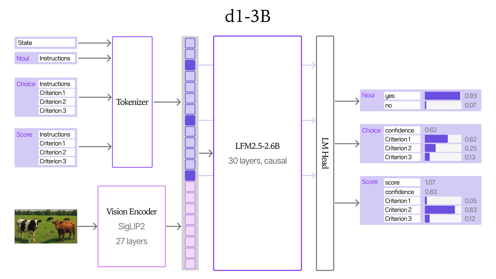

它真正改变的是 Agent 的结构。一个 Agent 的大量调用其实不是在「写」，而是在「判」：这一步做完了吗，证据够不够，这封邮件属于哪个意图。过去这些判断都交给主模型多跑一轮。本周 Hugging Face 论坛上有人在 360 个 SOP-Bench 用例上做了实验：把「步骤是否完成」和「有限选项的业务判断」交给 Jev，置信度不到 0.8 就退回 Qwen。结果主模型调用减少 29.6%，成本降低 26.6%，延迟降低 19.7%，360 个用例全部正确。

Vals 同一周的数据从另一面印证了这一点。把单个 Agent 换成 Agent 团队，成本涨到 1.8–5.1 倍，四组对比里只有一组分数提升在统计上显著。加模型、加 Agent 之前，不如先把「判断」从「生成」里拆出来。

换个角度看，这也是成本结构的变化。主模型按 token 计费，判断越多越贵；决策模型几乎只按输入计费，社区实测单次判断不到一美分。当 Agent 每个任务要做几十次判断时，省下的往往不是写代码的钱，而是反复确认的钱。

但别急着全面替换。社区实测中，有人用 choice 格式让 Decisions API 预测一枚 70% 正面的偏币，1000 次里 98% 选了正面，说明选项概率并不等于校准后的真实概率。另一位开发者对比发现，GPT-6 Luna 在细腻判断上自信答错的次数约是 Jev 的三倍。[Simon Willison](https://simonwillison.net/2026/Sep/21/jev/) 也提醒，你只拿到一个浮点数，拿不到理由，给求职者排序这类高风险场景尤其要小心。

我的判断是：决策模型适合做 Agent 里的「闸门」，不适合做「法官」。从有明确选项、有兜底、错了能回滚的判断开始，比如步骤完成检查、路由和工具选择；阈值用自己的标注集测出来，低置信度一律退回大模型。

## 本周快讯

- [GPT-6.1 Sol Ultrafast](https://developers.openai.com/api/docs/guides/ultrafast-mode) OpenAI 正式文档确认 `service_tier: ultrafast`；短上下文下 GPT-6.1 Sol 约每百万输入 / 输出 token 12 / 60 美元，建议 Agent 场景配合 WebSocket。
- [Meta 发布 Muse Wonder](https://research.meta.ai/blog/muse-wonder) Meta 首个前沿级模型，已通过 Meta Model API 与 Muse Code 提供，Muse Wonder Full 仅向 Muse Code 订阅用户开放。
- [Mistral Large 4 公开预览](https://mistral.ai/news/mistral-large-4/) 1T 总参数、52B 激活的多模态模型，预览 API 已上线 Mistral Studio，权重计划本月底发布。
- [Reflection 发布 Beam](https://reflection.ai/blog/introducing-beam) 501B 总参数、23B 激活的 MoE 编程与 Agent 模型，目前开放早期申请，权重与技术报告本月晚些时候发布。
- [Claude Code Projects 公开测试](https://code.claude.com/docs/en/claude-projects) 官方文档说明：一个 Project 由 Claude 协调多个并行云端线程，共享仓库与指令；目前面向 Pro / Max 逐步放量。
- [Cursor 手机遥控本地 Agent](https://cursor.com/changelog/remote-control-local-agents) 可在 Cursor iOS 应用里查看并回复电脑上的本地 Agent，Agent 仍在本机执行；企业组织需管理员开启。
- [Windows 推出 Agent 执行容器](https://blogs.nvidia.com/blog/local-ai-rtx-spark-microsoft-windows-event/) 微软宣布 Microsoft Execution Containers（MXC）正式可用；同场发布的 RTX Spark 笔记本最高 128GB 统一内存。
- [Personal Agent Protocol](https://sierra.ai/blog/introducing-personal-agent-protocol) Meta 与 Sierra 联合 Shopify、Stripe、Walmart 等起草开放标准，规定个人 Agent 如何认证并与企业网站、API 交互。
- [OpenAI 文本水印](https://openai.com/index/eu-text-provenance/) 为满足欧盟 AI 法案，欧盟区 ChatGPT 与 Codex 输出将加入隐形水印，API 可全球自愿开启；替换 25% 词语后检出率降到 17%。
- [GPT-6 进入免费版 ChatGPT](https://openai.com/index/gpt-6-for-everyone/) GPT-6 带来 Intelligent UI，回答可直接生成按钮、表单、图表等交互组件，免费与 Go 档由 GPT-6 Luna 驱动。
- [Claude 进入 Google 文档、表格和幻灯片](https://claude.com/resources/articles/claude-now-works-in-google-docs-sheets-and-slides) Claude for Google Workspace 在所有付费方案公开测试，可在侧边栏直接改文档、写公式、按母版生成幻灯片。
- [Claude 协助分解 RSA-896](https://saweis.net/posts/rsa-896.html) 一位 Anthropic 工程师用 Claude 把 CADO-NFS 移植到 GPU，在最多 2048 张 GPU 上跑了 10 天完成分解，作者称不影响 RSA-2048 的安全性。
- [example.com 为什么变瘦了](https://www.oliverdunk.com/2026/09/30/iana-reply) IANA 回复说：把说明拆进单独 JS，自动化流量就不拉脚本，带宽压力会小很多；它本来就不是给你做可用性探测的。
- [一个二维码指向两个应用商店](https://matthuggins.com/blog/posts/qr-codes-that-route-to-the-appropriate-app-store) 用独立短链主机按 UA 分流到 App Store / Play Store，适合印刷物料，避免印两张码。

## 技术文章

### [Agent 团队值不值：Vibe Code Bench 上的对照实验](https://www.vals.ai/blogs/multi-agent-vibe-code-bench)

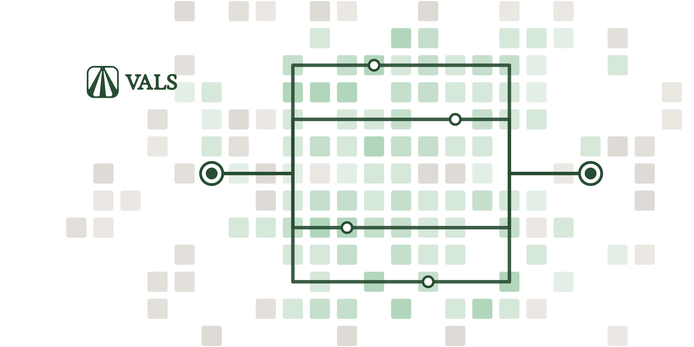

Vals AI 用 GPT-6 Sol 和 Claude Opus 5.5 在 50 个全栈 Web 应用上分别跑单 Agent 和 Agent 团队，各测中、高两档推理强度。

团队成本是单 Agent 的 1.8–5.1 倍，四组里只有 Sol 中档的 7.3 分提升显著。多出的钱主要花在缓存输入上：Opus 高档团队的子 Agent 每个应用要读约 2.24 亿缓存 token，单 Agent 只读 5500 万。

落地建议：别默认开多 Agent。先按「每个应用 / 每个任务」记账，对比同预算下「单 Agent + 更高推理强度」；只有子任务能真正并行时，团队才可能划算。

### [把有限判断交给决策模型：Agent 调用少 29.6%](https://discuss.huggingface.co/t/offloading-bounded-decisions-cut-agent-llm-calls-by-29-6-on-360-sop-bench-cases/190420)

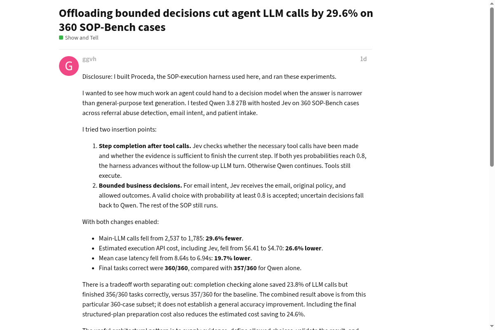

Proceda 作者在 360 个 SOP-Bench 用例上，把「步骤是否完成」和「邮件意图分类」从 Qwen 3.8 27B 交给 Jev 判断。

两个概率都达到 0.8 才跳过主模型，否则退回 Qwen。主模型调用从 2537 次降到 1785 次，成本从 6.41 美元降到 4.70 美元，但只开完成检查时正确数从 357 降到 356。

落地建议：已有 SOP 型 Agent 的话，挑一个有固定选项、能兜底的判断点接入就够了。阈值必须用自己的标注集定；只省调用却掉正确率，不算成功。

### [Anthropic 动态工作流：让 Claude 自己编排多 Agent](https://www.latent.space/p/claude-dynamic-workflows)

在 AI Engineer New York 上，Anthropic 介绍了 Claude Managed Agents 的 dynamic workflows：主 Agent 先做计划，再写一段编排程序来启动子 Agent、收集结果。

开发者不必再手配协调者和子 Agent 名单，但模型运行时并不知道预算，需要自己设置会话预算。子 Agent 之间只能通过共享文件系统交换信息，演讲者也承认 flows 比单 Agent 贵得多。

落地建议：适合批量扫描这类可拆成独立、可验证单元的大任务。会话预算是硬门槛；跑通后务必在 Console 调用图里核对每次交接的负载。

### [Devin 的记忆与「做梦」机制](https://devin.ai/blog/memory-and-dreaming)

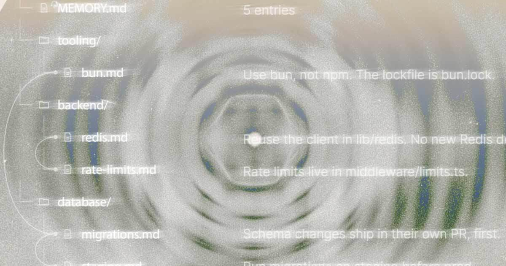

Cognition 为 Devin 加入 Memory 和 Dreaming：前者跨会话保留用户偏好、纠正与项目经验，后者每天在后台整理这些记忆。

记忆存在一个 Git 仓库里，由 `MEMORY.md` 做索引，Agent 按需检索，不把全部记忆塞进提示词。多个会话并发写入时用版本检查拒绝过期写入，冲突交给人处理，不会静默覆盖。

落地建议：自建 Agent 记忆可以直接照搬「Markdown + Git + 索引文件」。Cognition 已开源这套规范；建议先放在个人范围，别一上来做成团队共享指令。

### [如何搭建 AI 原生的软件工厂](https://www.theaithinker.com/p/how-to-build-an-ai-native-software)

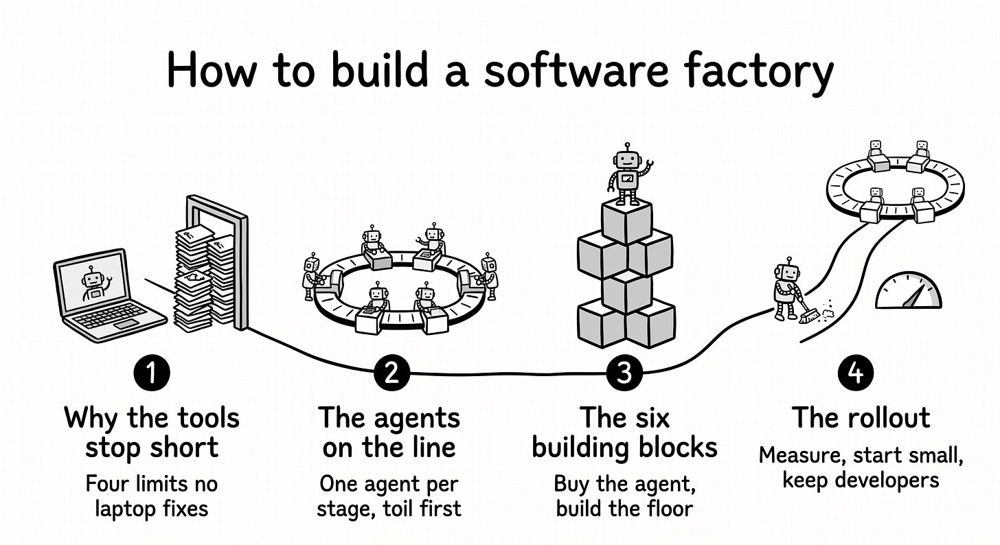

Adam Faik 梳理 Uber 等公司的 70 多份公开资料，回答「人人都有 Claude Code 之后，公司还要建什么」。

Uber 不自研编程 Agent，而是建模型网关、云端执行、Agent 身份等六个底座模块，并统一按「每个合并 PR 的成本」计价。最早交给 Agent 的是迁移和代码审查这类苦活，而不是新功能。

谁该关心：研发效能 / 平台团队。用 git 历史找出卡点，把一个现成 Agent 丢进最烦人的苦活；平台只补那条流水线真正缺的一块。

### [推测解码为什么快](https://jbarrow.ai/2026-10-08-why-is-speculative-decoding-fast/)

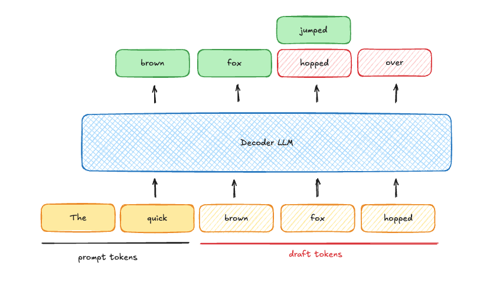

Joe Barrow 纠正一个常见误解：推测解码并没有少做计算，总 FLOPs 反而更多。

Key insight：单序列逐 token 解码是访存瓶颈，GPU 算力大量闲置；推测解码把这些空闲算力用来一次验证多个草稿 token，等于用「深度」换「广度」。批量一旦大到算力饱和，它就会拖慢所有序列。

落地建议：交互式编程助手这类低并发、重延迟场景值得开；高并发批处理先压测再决定。瓶颈在算力而不是访存时，打开它只会更慢。

### [Markdown 正在变成源码](https://htmx.org/essays/markdown-in-src/)

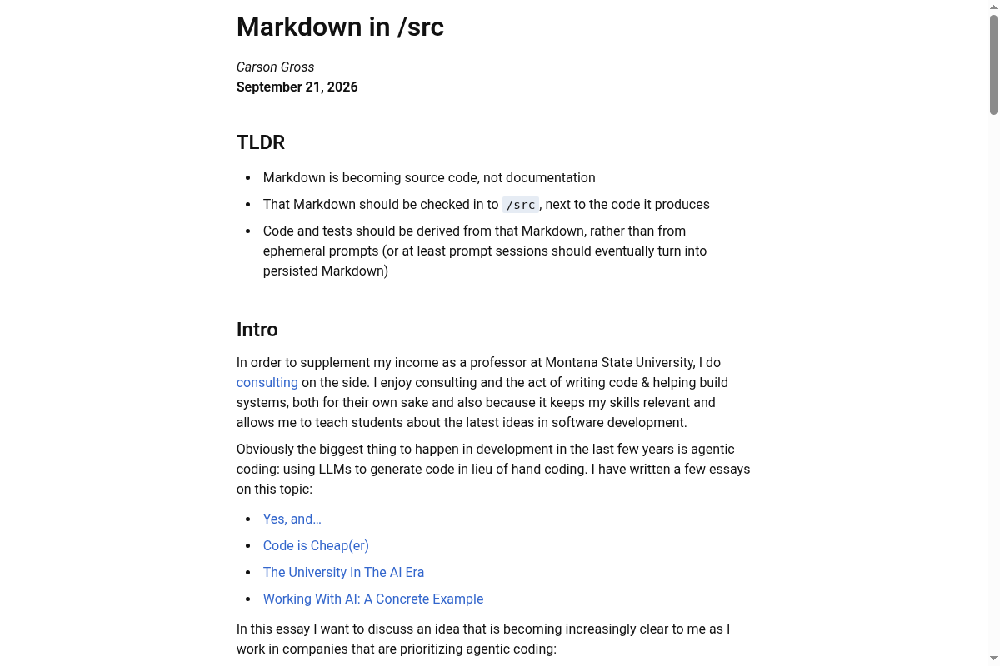

htmx 作者 Carson Gross 在咨询中观察到，重度使用编程 Agent 的公司里，Markdown 正从文档变成真正的源码。

他主张把描述需求的 Markdown 提交到 `/src`，与生成的代码放在一起，代码和测试都应从它推导，而不是来自用完即弃的提示词会话。阮一峰本周也推荐了这篇文章。

落地建议：已经在用 `AGENTS.md` 或 spec 的团队，可以把重要功能的提示词会话沉淀成仓库里的 Markdown，并跟代码一起评审。提示词用完即扔，后面很难复现。

### [如何为漏洞补丁修出一条快速通道](https://projectzero.google/2026/10/emergency-patching.html)

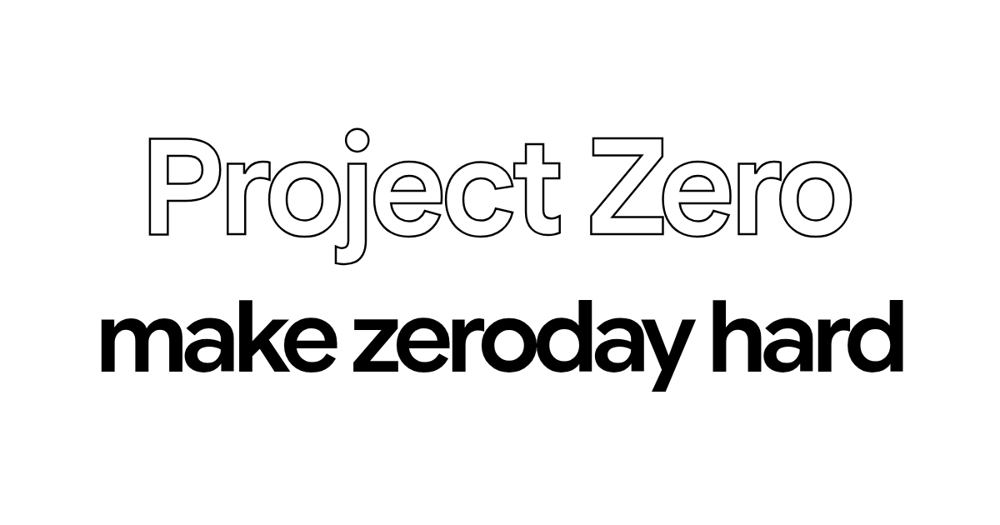

Google Project Zero 总结大厂如何绕开常规发版周期，快速修复正在被利用的漏洞。

补丁要经过分诊、开发、测试、合作方审核、分发、激活六个阶段，紧急情况下拖慢进度的主要是后几步。常见解法包括预先测试过的 feature flag，比如苹果 2019 年就用它临时关闭了群组 FaceTime。

落地建议：有客户端或长发版周期的产品，给编解码器、0-click 入口这类高风险模块预留可远程关闭的开关，并提前测过「开 / 关」两种状态。出了 0-day 再临时上开关，通常来不及。

### [我从 Deno 转回 Node](https://dbushell.com/2026/10/03/deno-to-node/)

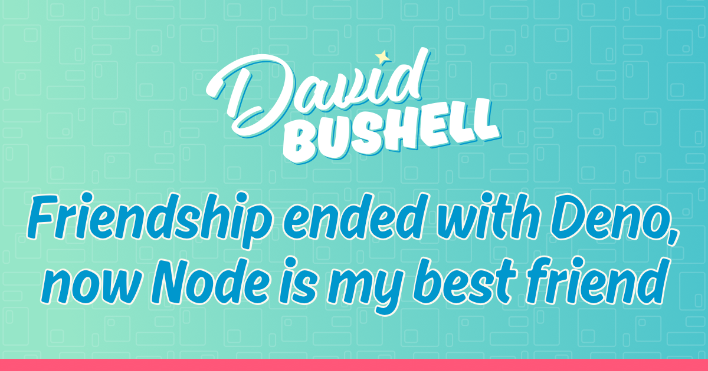

David Bushell 写自己在 SvelteKit 客户项目上重新拥抱 Node：现在的 Node 原生支持不少 ECMAScript 糖，也不再被迫天天碰 `require()`。

他用 FNM 管版本、PNPM 管依赖，并在 `pnpm-workspace.yaml` 里设 `minimumReleaseAge: 1440` 和 `trustPolicy: no-downgrade`，给新包留一天观察窗口，降低供应链投毒风险。

落地建议：还在 Deno / Node 之间摇摆的前端团队可以看看这篇实操笔记。编辑判断：更值得抄的是 PNPM 的发布延迟策略，而不是「该不该回 Node」这个结论本身。

### [C 的可变整数宽度不是设计失误](https://pikuma.com/blog/c-integer-sizes-not-a-mistake)

Pikuma 的 Gustavo Pezzi 从 12 / 18 / 36 / 60 位机器讲起，解释为什么 `int` 从来就不保证是 32 位。

作者回忆自己在 386 上 `sizeof(int)` 返回 2，而今天常见是 4。C 的灵活整数宽度是为了在词长混乱的机器世界里保持可移植，不是早期偷懒。

谁该关心：写跨平台 C / C++、嵌入式或复古主机代码的人。需要固定宽度时请用 `stdint.h` 的 `int32_t` 一类类型，别假设 `int == 32-bit`。

## 工具推荐

### [OpenAI Decisions API：只返回概率的判断接口](https://developers.openai.com/api/docs/guides/decisions)

OpenAI Decisions API 进入公开测试，基于 GPT-6 Luna，支持文本和图片输入，官方文档称比 Responses API 快约 10 倍。

它提供 predicate / choice / score 三种输出；每百万输入 token 0.10 美元，不收输出费，目前也没有缓存折扣。同周横向对照：Microsoft-Decision-1 约 0.042 美元 / 百万输入（Foundry / OpenRouter），Cloudflare Clef-flash 降到 0.038 美元 / 百万输入，Clef-omni 还能直接吃音频和视频。

落地建议：图片审核、截图分类这类多模态判断可以拿它开干。社区实测 choice 格式容易把概率堆到首选项上，要校准分布时优先用 predicate。

### [Liquid AI d1：能跑在 Jetson 上的开源决策模型](https://www.liquid.ai/blog/d1-open)

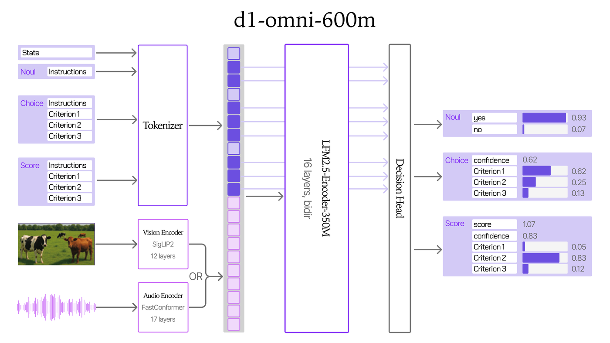

Liquid AI 开源 d1-3B 和 d1-omni-600M，首日支持 llama.cpp，适合本地或边缘部署。

d1-3B 在 Decision Index 公开集上得 48.57 分，与 12 倍体量的 Decider 35B-A3B 持平。RTX 4090 上单次判断 8ms，Jetson Orin Nano 上也只要 50ms。

落地建议：数据不能出本地、又要毫秒级判断时很有竞争力。d1-omni-600M 仍是实验版本，生产环境用 d1-3B 更稳。

### [Claude Haiku 5.5：降价约 75% 的小模型](https://www.anthropic.com/claude-haiku-5-5)

Anthropic 发布 Claude Haiku 5.5，定位高并发、低成本任务，也适合做 Opus / Sonnet 的编程子 Agent，并首次在 Haiku 档支持推理强度调节。

100k token 以内的提示词，每百万输入 / 输出 token 为 0.10 / 0.50 美元，Haiku 4.5 是 1 / 5 美元。Terminal-Bench 4.0 从 0% 升到 39.2%；同时 Sonnet 5.5 缓存读取减半，多数 Agent 任务大约便宜 20%。

落地建议：摘要、上下文压缩、分类这些子任务很适合切过来。注意提示词超过 100k token 后单价会涨到约 5 倍。

### [Quicksand：用 QEMU 虚拟机给 Agent 做沙箱](https://github.com/microsoft/quicksand)

微软开源 Quicksand，一个异步 Python API，用来启动、控制和快照 QEMU 虚拟机，专门面向 AI Agent 沙箱。

它提供预构建的 Ubuntu / Alpine 镜像，支持 macOS、Linux、Windows 上的 x86_64 与 ARM64，运行不需要 root 或 Docker。沙箱默认断网，可挂载主机目录，并为多个 Agent 分别创建 Linux 用户。

落地建议：容器隔离不够放心、又不想上云端沙箱的本地 Agent，用 `pip install 'quick-sandbox[qemu,alpine]'` 就能把快照与回滚跑通。

### [EmbeddingGemma 2：740M 的端侧多模态向量模型](https://blog.google/innovation-and-ai/technology/developers-tools/embeddinggemma-2/)

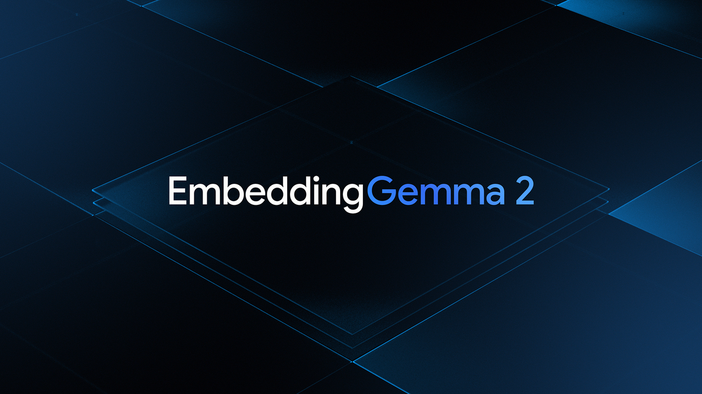

Google 发布 EmbeddingGemma 2，把文本、代码、图片、音频和视频映射到同一向量空间，Apache 2.0 许可。

纯文本只需 270M 参数，视觉和音频编码器按需加载。向量可从 768 维截断到 128 维，存储最多省 6 倍；上下文 8K，量化后纯文本版大约 191MB 内存。

落地建议：本地 RAG 或跨媒体搜索，用 256 / 128 维版本先看召回率，不够再加载多模态编码器。一上来就上全量编码器，内存账会很难看。

### [OpenDocRouter：一个 API 调用所有文档解析模型](https://www.llamaindex.ai/blog/introducing-opendocrouter)

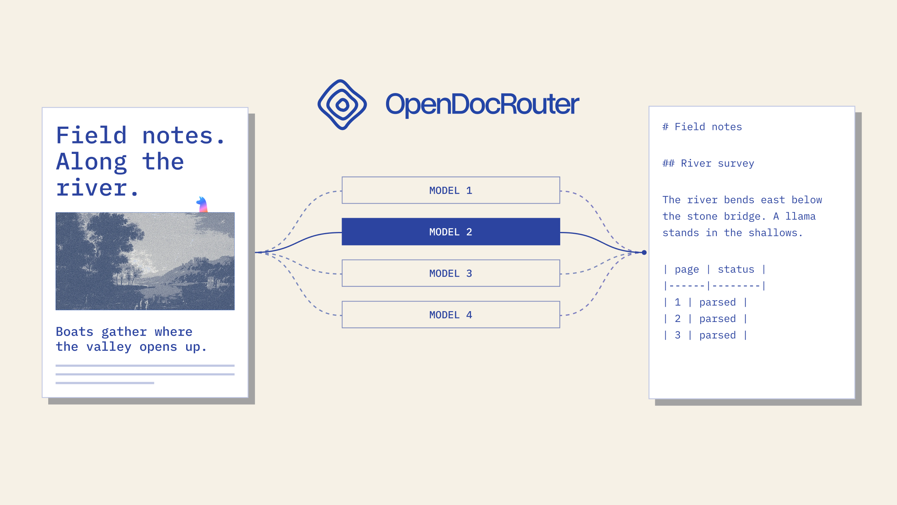

LlamaIndex 推出 OpenDocRouter，用统一 API 把 PDF 和图片解析成 Markdown，底层可选 Claude、Gemini、GPT 或 MinerU、PaddleOCR-VL 等开源模型。

每个模型都有版本化配方，并在 ParseBench 上公布质量和成本。开启 `layout` 后输出统一版面类别和边界框；同步请求最多 50 页。

落地建议：文档解析还在横向选型时很省事。同一批真实文档跑一轮，再决定要不要自部署某个开源模型。

### [Devin Security Swarm：并行 Agent 做代码安全扫描](https://docs.devin.ai/work-with-devin/security-swarm)

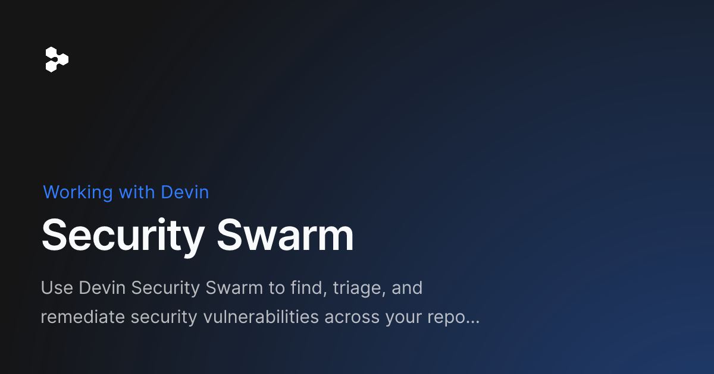

Cognition 推出 Security Swarm，先为仓库生成威胁模型，再调查、验证潜在漏洞，并通过 PR 帮助修复。

它用「Agentic MapReduce」把仓库切给多个并行 Devin，覆盖 RCE、SQL 注入、SSRF、越权等类型，还能识别跨文件组合利用。扫描分 Normal 和 Deep 两档。

落地建议：已经在用 Devin 的团队更合适。高风险仓库首扫用 Deep，之后用 Normal 做增量，并在扫描历史里核对每次 ACU。

### [DockTerm：在 Mac 刘海里回应 Claude Code](https://github.com/munvard/dockterm)

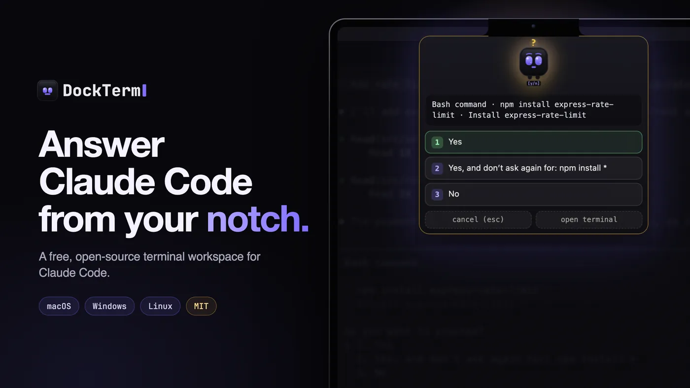

DockTerm 是一个开源终端工作区，可并排运行多个 Claude Code 会话，并把权限请求弹到 Mac 刘海区域，全屏应用里也能直接回应。

基于 Electron 和 xterm.js，MIT 许可；阮一峰本周也收录了它。目前星标还不多，属于早期项目。

落地建议：同时开多个 Claude Code、经常卡在权限确认上的 macOS 用户会有体感。公司代码进它之前，先看清权限与网络行为——这是编辑的保留意见。

### [Snitch：本机网络连接可视化](https://github.com/aixisstudio/Snitch)

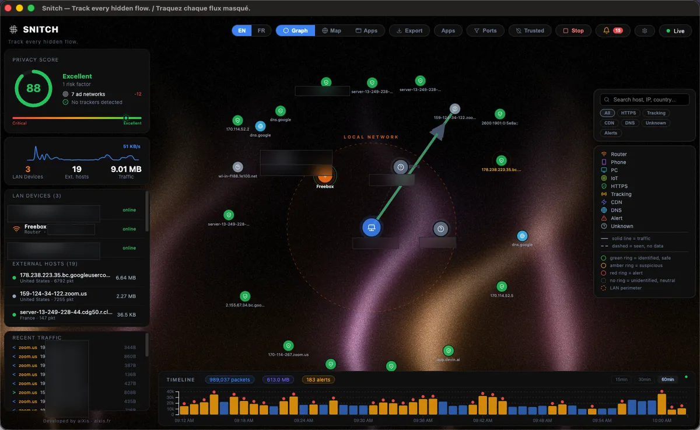

Snitch 是一个实时网络流量可视化工具，用图展示本机每个进程正在跟谁通信，100% 本地，AGPL-3.0。

技术栈是 Electron + React + FastAPI + D3，支持 macOS / Linux / Windows，定位有点像开源的 Little Snitch 观察层。

落地建议：排查「哪个开发工具又在偷偷联网」时很好用。编辑判断：比再装一个杀毒套件轻得多，也更适合开发者日常排障。

### [EdgeChat：跑在 Cloudflare Workers 上的自托管聊天](https://github.com/aozorae/Edgechat)

EdgeChat 是一套完全跑在 Cloudflare Worker 上的即时通讯系统，支持群聊、私信、Telegram 双向桥接，以及消息与文件加密。

仓库约 1k star，GPL-3.0；前端 + Worker 架构，文档里还提到 WebMCP。适合想自建轻量团队聊天、又不想养一台长驻服务器的人。

落地建议：小团队或侧项目可以当 Slack 轻量替身来试。有合规要求的公司环境，部署前核对加密与数据驻留说明。

### [Naive Icons：手绘风 SVG 图标库](https://github.com/guokaigdg/naive-icons)

Naive Icons 是一套手绘「素人」风格的 SVG 图标，面向 React / TypeScript，MIT 许可。

有意思的是它还带 AI Agent Skill：装进 Claude Code / Cursor 后，Agent 可以按语义挑图标并写出可直接用的代码。

落地建议：做个人站或内部工具、想要一点非「设计系统味」时可以取用。正式产品设计系统未必合适，但当 Agent 填空图标很方便。
