## 卷首：Agent 的成本，藏在你离开的那几分钟

你让编码 Agent 改一个模块，它读文件、跑测试、调工具，一轮接一轮，很快。然后它停下来问你：「这个接口要不要保持向后兼容？」你正好去吃午饭，一小时后回来答了一句「要」。这句回答之后的那次请求，比之前任何一轮都慢，也都贵。

原因在 KV 缓存。Agent 每一轮都会把整段对话重新发给模型，服务端如果还留着上一轮算好的前缀，就能跳过重复计算；留不住，就得从头 prefill 一遍。Siddhant Khare 这周整理的[推理实测综述](https://siddhantkhare.com/writing/agentic-inference-field-guide)把这件事说得很清楚：Agent 丢缓存有两种方式，一种是显存满了被挤掉，另一种是人停太久、TTL 到期被扔掉。现在的基准几乎只测前一种。

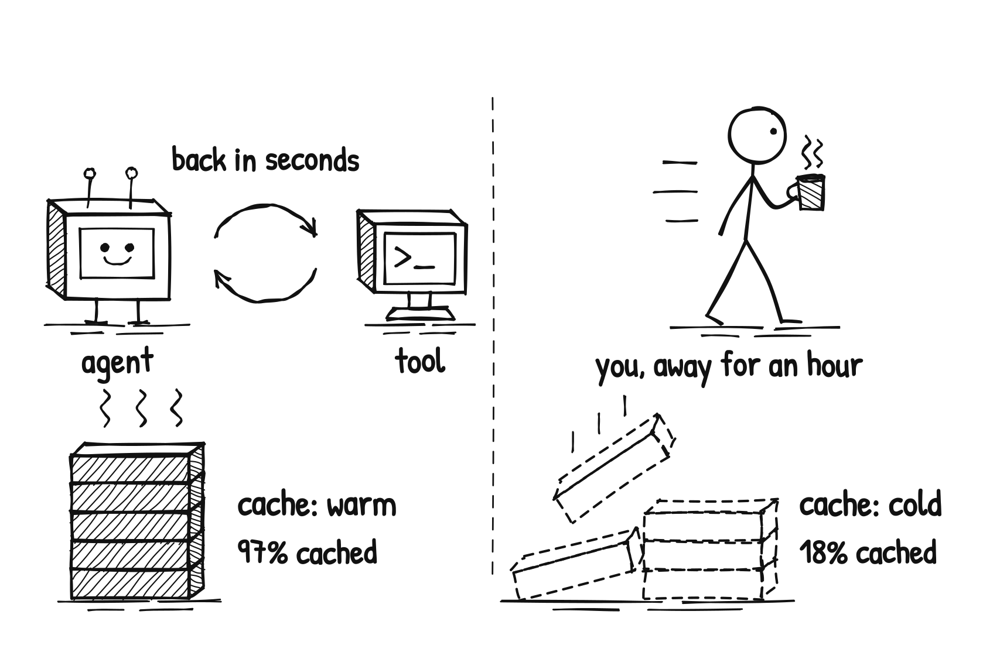

数字很直观。哈佛团队运营的免费推理网关 FreeInference 统计了 12002 个会话：工具调用之间的平均命中率是 97%，Agent 问你问题后是 92%，你闲置后只剩 84%。停 15 到 30 分钟，命中率约 58%；停一小时以上，只有 18%。微软对 GitHub Copilot 编码 Agent 一周流量的研究也类似：同一轮内命中率 90%，跨轮次只有 55%，切换模型和上下文压缩还会「大幅」打掉缓存。

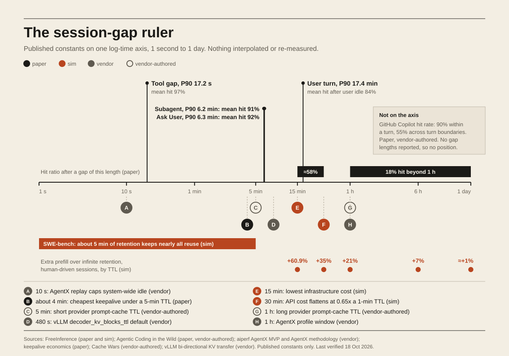

更值得注意的是基准和现实的落差。SWE-bench 这类无人参与的回放，只要约 5 分钟缓存保留期就能吃满复用；有人参与的会话要约一天。在 15 分钟 TTL 下，真人会话要比「缓存永不过期」多 prefill 60.9% 的 token。工具调用 P90 是 17.2 秒回来，人是 17.4 分钟回来。我们天天看的推理基准，测的是 Agent 自己跑的那段，恰好漏掉了最贵的那段。

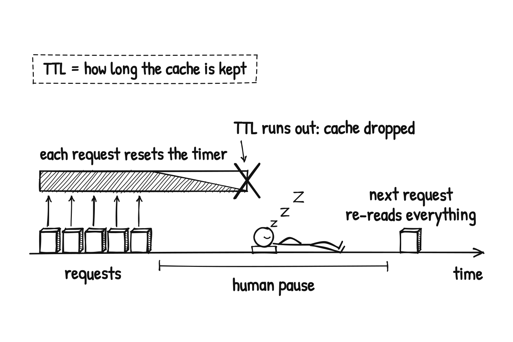

保留意见也要说。这些数字大多来自预印本和厂商自测，FreeInference 只是一个免费网关，用户构成不代表企业流量；不同上游差异也很大，同一份数据里有家供应商一小时后仍能保持高命中。再者，「多留缓存」本身要占显存，对服务方是真金白银，不是免费的午餐。

我的判断是：缓存命中率应该按「停顿类型」拆开看，而不是只看一个平均数，95% 的均值可能藏着闲置后的 84%。用 Agent 的团队，先把需要人确认的问题攒到一起问，别让它每走几步就停下来等你；压缩上下文、切换模型都当成缓存事件来记账。付费调用 API 的，把 keepalive 间隔设成略小于供应商 TTL 的最大值，并用「每个成功任务的成本」而不是每百万 token 价格来比较方案。

## 本周快讯

- [DeepSeek V4.1 Flash 1017](https://huggingface.co/deepseek-ai/DeepSeek-V4.1-Flash-1017) 新权重开放，推理、编码与 Agent 任务全面提升，跨层 KV 复用加 FP4 KV 缓存把每 token 缓存压到 890 字节。
- [MiniMax M3.1 Flash](https://www.minimax.io/blog/minimax-m31f) 主打 Agent 与 Computer Use，官方称在线推理快近 3 倍、使用成本降 70%，权重稍后开放。
- [Mercury 3](https://www.inceptionlabs.ai/blog/introducing-mercury-3) Inception Labs 的扩散式语言模型，生成速度超过每秒 1000 token，官方称多项基准超过 GPT-6 Luna 和 Claude Haiku 5.5。
- [Nemotron 3.5 Super VL](https://developer.nvidia.com/blog/nvidia-nemotron-3-5-super-vl-powers-specialized-agents-with-multimodal-reasoning/) NVIDIA 多模态推理模型，同时放出更小的 Nemotron 3.5 Bolt 74B-A9B 与近无损 NVFP4 量化权重。
- [Muse Spark Open](https://research.meta.ai/blog/muse-spark-open) Meta 开放 816B 参数（42B 激活）的多模态权重，1M 上下文，可用 MLX 在两台 M5 Ultra Mac Studio 上本地跑。
- [Voxtral 3](https://mistral.ai/news/voxtral-3/) Mistral 发布 50 多种语言的语音识别与合成模型，附带打通听、想、说的语音 Agent SDK。
- [Grok Voice 3.0](https://x.ai/news/grok-voice-3) xAI 的语音到语音模型更新，延迟低于一秒，客服场景表现提升。
- [TorchTPU](https://pytorch.org/blog/introducing-torchtpu/) Google 与 Meta 推出开源 PyTorch TPU 后端，支持 eager 执行与 torch.compile，迁移不再依赖 JAX。
- [Exa 3.0](https://exa.ai/blog/exa-3) 面向 Agent 的搜索引擎升级，新出 Exa Lite 每千次请求 4 美元，自建索引覆盖 2 万亿 URL。
- [老旧语言编码](https://openai.com/index/low-resource-programming-languages/) OpenAI 发布 MultiLangBench 与 COBOL 迁移评测，GPT-6.1 Sol 低推理档 COBOL 迁移准确率 86.6%，评测已开源。
- [Codex 的来路](https://every.to/p/how-codex-happened) Every 长文复盘 Codex 从云端版本失利到周活超过 4000 万的过程。
- [Stack Overflow for Agents](https://openai.com/index/stack-overflow-chatgpt-plugin) 接入 ChatGPT 插件后，注册量一夜翻了三倍。
- [Replit 换默认模型](https://techcrunch.com/2026/10/17/replit-is-no-longer-working-with-anthropic-ceo-says/) Replit Agent 首选供应商从 Anthropic 换成 OpenAI，用户仍可手动选 Claude。
- [TypeScript 7.1 Beta](https://devblogs.microsoft.com/typescript/announcing-typescript-7-1-beta/) 新增 ES2026 target、source phase imports 与构建开发工具的新 API，官方称比 7.0 最多快 2.5 倍。

## 技术文章

### [Claude Code 团队怎么做 code review](https://claude.dev/blog/solving-code-review-at-anthropic/)

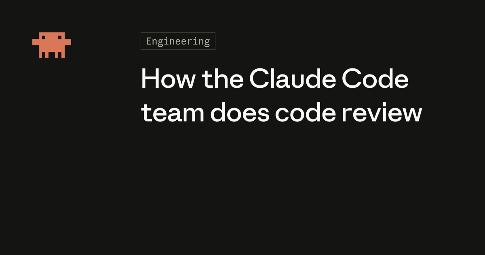

Anthropic 的 Addy Osmani 等人分享 Claude Code 团队的评审流程：把大部分「读代码」交给机器，人只看最需要判断的部分。

6 月到 9 月，Claude Code 仓库合并的 PR 翻了一倍多，回滚比例反而降了四成以上；Anthropic 单仓每天落地的变更从约 2500 个涨到 3 万多个。评审从「末端闸门」变成写代码时持续运行的拼写检查，并大量投入让回滚变得又快又容易。

落地建议：PR 量被 Agent 撑大的团队，先把「人读过没」换成「这次改动可能出什么错、该由哪道检查拦」，再给回滚流程补工具。

### [Thin Orchestrator：路由做得越少，Agent 越可靠](https://engineering.fb.com/2026/10/19/ml-applications/thin-orchestrator-ai-agent-architecture/)

Meta 数据管线团队把一个装满领域知识的单体 Agent，拆成 1300 行的薄编排器加 14 个专职 Agent，覆盖 20 多个工作流。

单体 Agent 在上下文超过某个阈值后会「串味」，把一个子系统的命名规则用到另一个上；改造前的单 Agent 方案成功率 70%–80%，还得逐任务手调提示词。薄编排器只管顺序和可靠性检查，领域判断全部下放。

落地建议：Agent 提示词越写越长、效果越来越差时，先把编排层的领域知识搬出去，让路由只负责派活和校验。

### [Router 是 AI 技术栈的新原语](https://www.vals.ai/blogs/routers-new-ai-primitive)

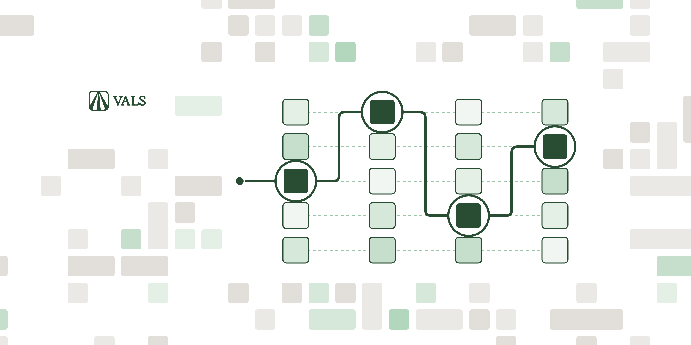

Vals 用自家评测说明为什么需要模型路由：没有一个模型在所有任务上都领先。

Vals Index 八个基准的榜首分属五个模型，没有模型能在全部基准都进前三；Claude Opus 5.5 总榜第三，在 Harvey 法律 Agent 基准却排第 33。光上个月就有 10 家厂商发了 16 个语言模型。

落地建议：多工作流共用一个模型的团队，先挑 2–3 个代表任务跑自己的 eval，再决定用路由器还是按工作流固定选型。

### [让任何 harness 都能断点续跑](https://vercel.com/blog/making-every-harness-durable)

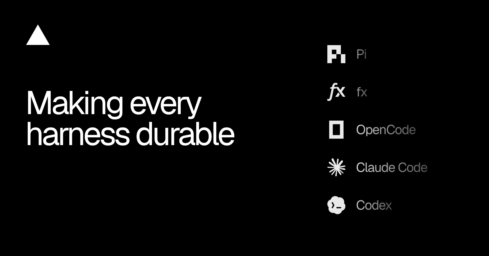

Vercel 推出 durable-harness，让 Pi、OpenCode、Codex、Claude Code 等 harness 在云端崩溃或函数超时后能从日志恢复。

它复用 Workflow SDK 的机制，记录已完成的模型和工具调用，新函数读日志接着跑，已完成的工作不重做；也支持用自己的 Postgres 自托管。

落地建议：想把编码 Agent 从笔记本搬到云上全天运行的个人或团队，可以先拿一个等 CI 的长任务试它的恢复能力。

### [Ramp 是怎么做内部 Agent 平台 Laminar 的](https://builders.ramp.com/post/building-laminar)

Ramp 试遍了模型厂商的 Agent SDK、托管 Agent API、开源编码 Agent 和各种框架，最后在 2026 年 5 月决定自建统一平台 Laminar。

口号是「build agents, not infrastructure」：把 Agent 开发的公共部分抽成平台层，产品团队从第一天就是它的用户，月结、报销、短信助手等产品都跑在上面。

落地建议：公司里已有三套以上 Agent 框架并存时，可以对照这篇盘点哪些能力该收进平台，哪些留给业务团队。

### [Vercel AI Gateway 10 月生产指数](https://vercel.com/blog/ai-gateway-production-index-october-2026)

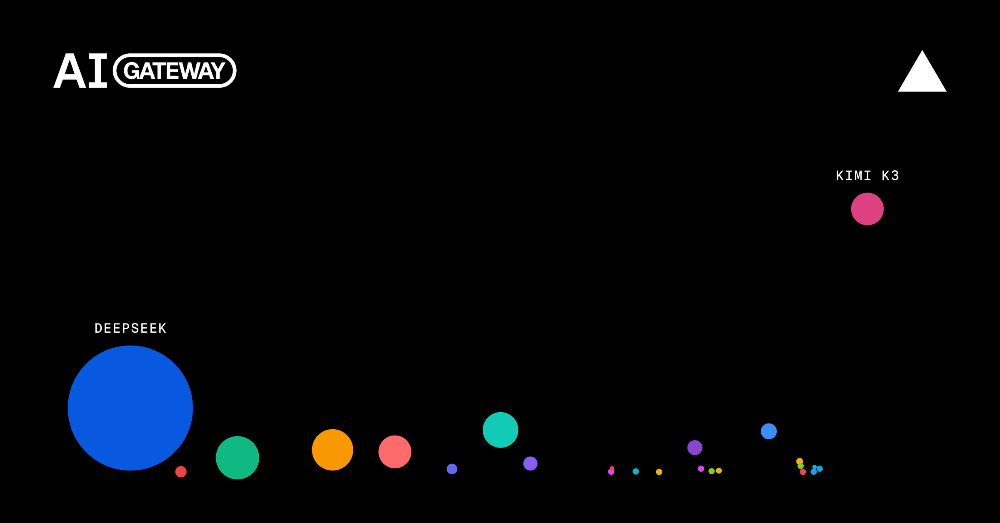

Vercel 每月公开网关流量统计，本期最大变化是开放权重模型处理了超过七成 token，花费占比也接近四分之一。

DeepSeek-V4.1-Flash 一个模型就跑了 9 月近一半 token，却只占 2.6% 花费；9 月网关总花费是去年 12 月的 13 倍，平均 token 单价降了 47%，近三分之一团队换了最常用的厂商。

落地建议：先把高频、简单的调用切到开放权重模型做灰度，复杂任务留给前沿模型，按每任务成本对比。

### [给个人网站加一个 MCP server](https://hacdias.com/2026/10/17/mcp/)

Henrique Dias 在自己网站的 Go 后端里加了 MCP server，现在拍一张电影票，Claude 就能把观影记录写进网站。

动机很朴素：想动手理解 MCP 和 Agent 怎么调 API，又要找一个真正有用的场景。原来的流程是打开网页编辑器手改文件，现在变成拍照、打分、交给 Agent。

落地建议：想入门 MCP 的开发者，不妨从自己的博客或笔记后端开刀，先暴露一两个写入接口练手。

### [Anthropic：AI 如何重塑自家的工作与雇佣](https://www.anthropic.com/research/employment-at-anthropic)

Anthropic 用内部雇佣、AI 使用、产出与日历数据，加上 17 场访谈，研究 AI 怎样改变公司的工作方式。

到 8 月，交互式 Agent 的工作时长已是员工的 6 倍；初级技术岗招聘占比下降，招聘方更看重自主性和判断力。人的注意力成了瓶颈，即使非技术员工，读完自己 Agent 的全部产出也要占去半个工作周。

谁该关心：带团队、做招聘规划的技术管理者，可以借它思考「审阅 Agent 产出」这份新工作该怎么分配。

### [重试反而让系统更糟：过载保护](https://wendelladriel.com/blog/when-retries-make-things-worse-protecting-your-system-from-overload)

Wendell Adriel 从一个运费报价接口变慢说起：它没报错，只是从 100 毫秒变成 2 秒，健康的应用就被拖垮了。

文章给出一套做法：按整条调用链统计重试次数，给整个操作设截止时间，排队前先限并发，跨请求设重试预算，并把重试决策收归一处、做成可观测指标。

落地建议：调用 LLM API 这类慢依赖的服务，先检查是否每层都在各自重试，把重试统一到一层并加上预算。

### [Interop 2027：最期待的 10 个 CSS 特性](https://www.joshwcomeau.com/css/interop-2027/)

Josh Comeau 列出他希望进入 Interop 2027 的 10 个 CSS 特性。Interop 是各大浏览器厂商共同推进兼容性的项目。

进入 Interop 的特性通常一年内就能接近全浏览器支持，比如 Subgrid 在 2019 年就进了 Firefox，直到入选 Interop 2023 才在当年普及。

落地建议：前端团队可以对照清单，规划明年哪些特性能从渐进增强转为默认方案。

## 工具推荐

### [Context Mode：给编码 Agent 省上下文的 MCP server](https://github.com/mksglu/context-mode)

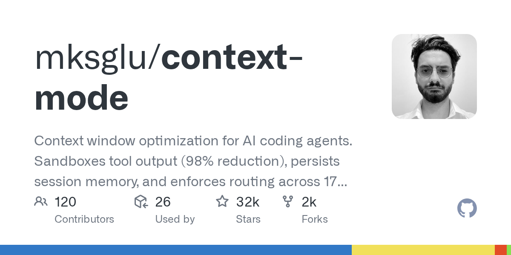

本周 GitHub 周榜项目。它用沙箱接住工具输出，不让原始数据直接灌进上下文。

README 举例：一次 Playwright 快照 56 KB，20 个 GitHub issue 59 KB，半小时就吃掉 40% 上下文；经它处理 315 KB 变 5.4 KB。它还把文件编辑、任务和决定记进 SQLite，压缩后能接上，支持 17 个平台。

落地建议：常用浏览器、日志类 MCP 工具的人可以先装上，对比上下文占用和压缩频率；压缩少了，缓存也更稳。

### [CLI-Anything：让任意软件变成 Agent 可用的 CLI](https://github.com/HKUDS/CLI-Anything)

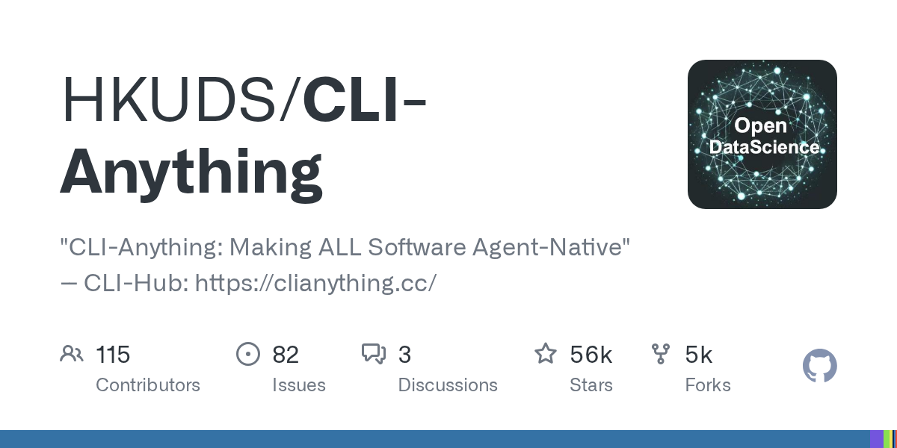

港大 HKUDS 的项目，为现有软件生成命令行接口，让 Agent 用命令而不是点界面来操作，本周上了 GitHub 周榜。

配套的 CLI-Hub 用 `pip install cli-anything-hub` 安装，再 `cli-hub install <name>` 获取社区做好的 CLI，演示覆盖 CAD、3D、图表、字幕等场景。

落地建议：想让 Agent 操作某款没有 API 的桌面软件时，先去 Hub 搜有没有现成 CLI，再考虑自己写。

### [OpenCode 2.0](https://anoma.ly/notes/opencode-2-0/)

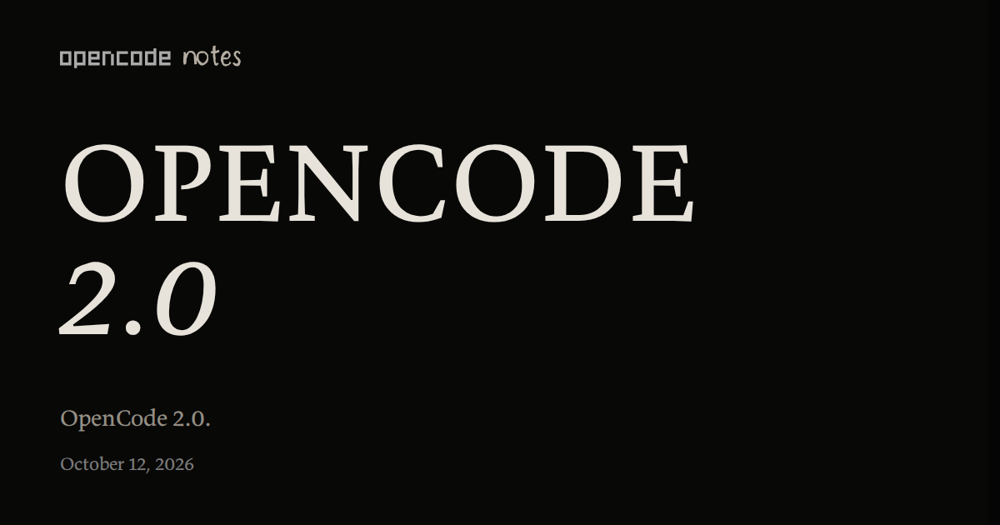

开源编码 Agent OpenCode 发布 2.0 大版本。

最大的变化是服务化：本机自动常驻一个后台进程，TUI、网页和桌面端都连它，会话互通；`@opencode/client` 脚本能自动发现本地服务，适合跑定时任务。

落地建议：想用开源 CLI 替代闭源编码 Agent，又需要多端切换或定时任务的开发者可以升级试用。

### [Claude 平台接入 OpenTelemetry](https://claude.com/resources/articles/agent-observability-on-the-claude-platform)

Claude Managed Agents、Messages API 和 Claude SDK 现在都能导出 OpenTelemetry trace，包括每一轮、每次模型调用和工具调用。

trace 遵循 OTel GenAI 语义约定，带延迟、token 和 ID，可直接进 Grafana Cloud、Honeycomb、Sentry、Splunk，和其他服务的日志指标放在一起看。

落地建议：已有 OTel 体系的团队，在 Claude Console 加一个目的地即可接入，按 trace 观察稳定后再逐步放宽 Agent 权限。

### [Perplexity 开源 Agent 沙箱 SPACE](https://www.perplexity.ai/hub/blog/open-sourcing-space)

Perplexity 开源了 SPACE，也就是它的 Computer Agent 背后的沙箱基础设施。

对需要让 Agent 执行代码、操作文件的产品来说，沙箱的隔离、启动速度和资源回收往往比模型本身更难做；这是又一个经过生产验证的开源选项。

落地建议：准备自建代码执行沙箱的团队，先拿它和现有托管沙箱对比启动延迟与隔离级别。

### [Liquid d1-ultra：多模态决策模型](https://www.liquid.ai/blog/d1-ultra)

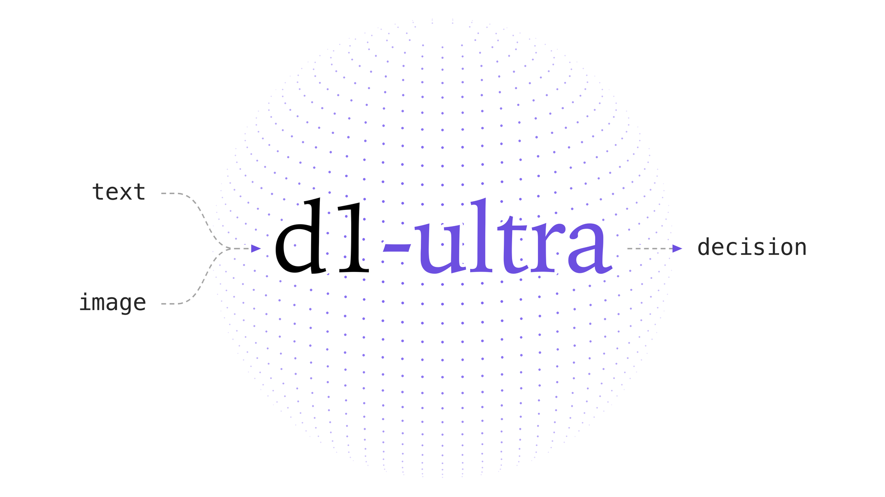

接着上期的话题：Liquid AI 发布 d1-ultra，面向更难、更乱的真实判断，比如对照规格找电路板缺陷、对照照片核理赔。

它接收文本和图片，一次前向返回每个答案的概率，不生成 token；支持是非、多选、打分三种题型，价格为每百万输入 token 0.042 美元。

落地建议：Agent 里带图片的是非判断，可以先用自己的标注集测阈值，低置信度再退回大模型。

### [Cloudflare Clairic：抽取模型](https://blog.cloudflare.com/clairic-extraction-model)

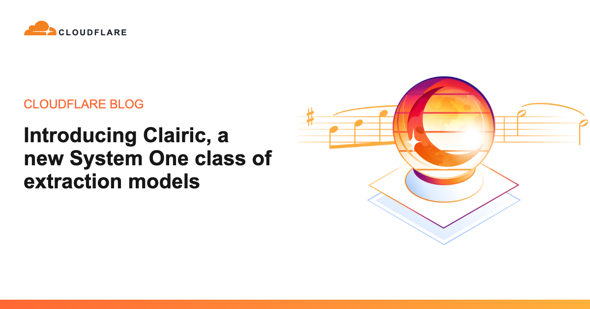

Cloudflare 在 Workers AI 上预览 Clairic（`@cf/cloudflare/clairic`），这是继决策模型之后的「System One」抽取模型，计划开放权重。

它从非结构化输入中抽取、计算或预测数值，比如发票总额、延误天数、维修费用，数字附带 80% 区间；只收输入费，通常一秒内返回。

落地建议：同一种结构化输出反复调大模型的流程，可以先挑一个字段切到 Clairic，对比准确率和单次成本。

### [DeepSeek Search & Fetch API](https://api-docs.deepseek.com/guides/search/)

DeepSeek 推出两个原生工具接口：Search 基于自研搜索引擎返回结构化结果，Fetch 把单个网页转成 Markdown。

两者是纯 JSON API，地址分别为 `/v1/tools/search` 和 `/v1/tools/fetch`，和 DeepSeek API 共用 Bearer 鉴权，搜索可选同时返回正文。

落地建议：已在用 DeepSeek 的 RAG 或研究型 Agent，可以用它替换自维护的爬虫，先比较召回质量和延迟。

### [Databricks MemCurrent：生产 Agent 的持久记忆](https://www.databricks.com/blog/memcurrent-designing-persistent-memory-production-agents)

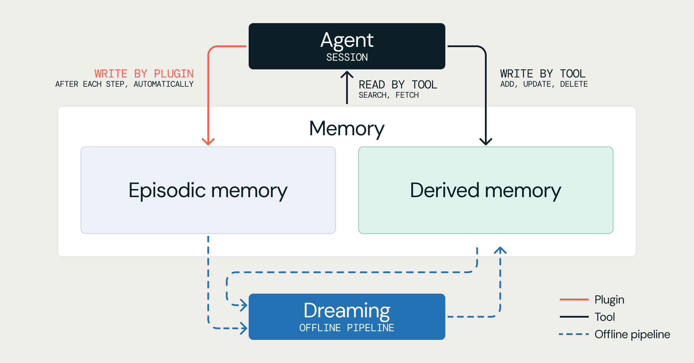

Databricks 发布 MemCurrent 记忆系统，已用于 Agent Bricks Memory 与 Genie。

它同时用三种接入方式：插件式自动读写、工具式由 Agent 决定、离线「做梦」流水线定期整合。在内部企业任务基准上，通过率是无记忆的 3 倍，token 少 31%，速度快 26%。

落地建议：设计 Agent 记忆层时，先想清楚哪些记忆必须实时生效、哪些可以离线整合，别把全部历史都塞进上下文。

### [Google Harness²：自我改进的 Agent harness](https://github.com/google-research/harness2)

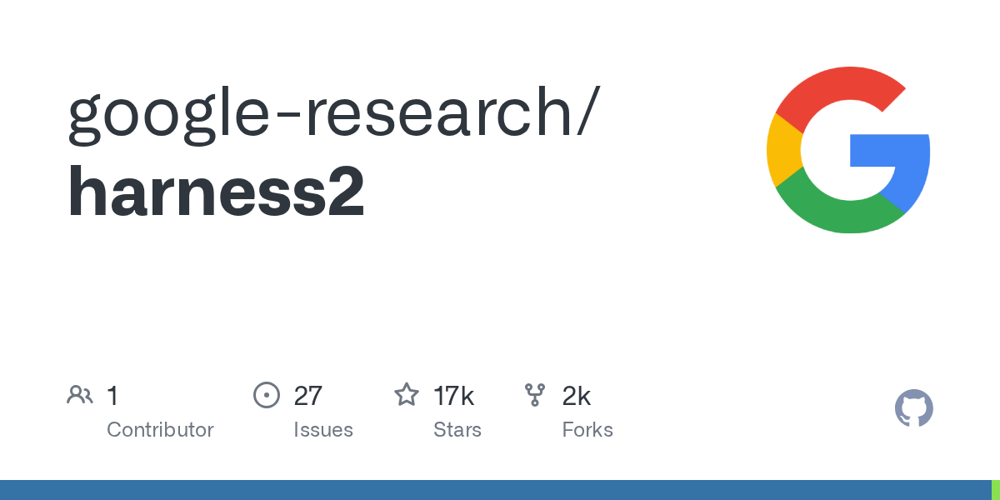

Google Research 开源的框架，不改模型权重，只优化模型周边的提示词、工具、记忆和编排。

任务层面用「提议、试探、组合」三步，在同一任务上对比多次执行来改进 harness，不需要标准答案；再把有证据支持的经验沉淀下来，供以后的任务复用。

落地建议：维护自家 Agent harness 的团队，可以借鉴它「同任务对比执行」的思路做自动调优实验。

### [llm-d：K8s 原生的分布式推理](https://llm-d.ai/)

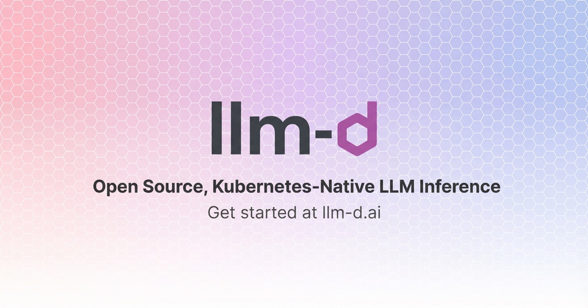

llm-d 在 Kubernetes 上把 vLLM、SGLang 等单机推理引擎组成集群级服务，支持 GPU、TPU、XPU、CPU 等硬件。

它提供经过测试的部署配方，包括按预测延迟路由、前缀缓存感知路由、分层前缀缓存、prefill/decode 分离和自动扩缩容。

落地建议：自托管推理已到多节点规模、又被缓存命中率困扰的团队，可以先试它的前缀缓存感知路由配方。

### [tsrs：TypeScript 的 Rust 移植](https://blog.cloudflare.com/typescript-rust-port/)

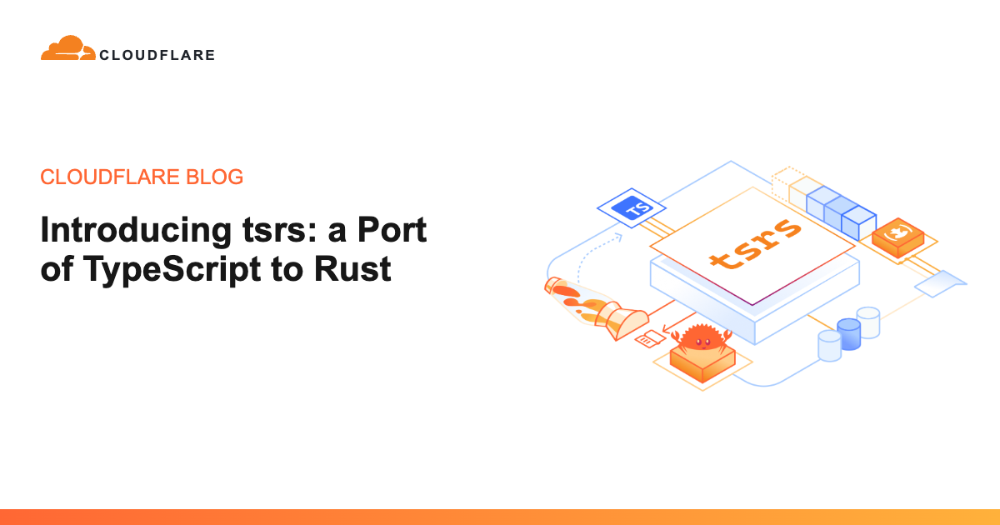

Cloudflare 与 VoidZero 合作，在 Oxc 工具链里孵化 tsrs，并与 TypeScript 团队协作，明确表示不分叉语言。

早期基准显示，同样的类型检查 worker 数下，tsrs 比 TypeScript 7.0 最多快 8 倍，内存少约 70%；部分优化已回流进 TypeScript 7.1。

落地建议：大型 TS 仓库可以用 `npx tsrs` 在本地对比类型检查耗时，目前是实验版本，别直接接进生产 CI。
