## 卷首：subagent 该合回主循环了

去年大家搭 Agent 的标准姿势，是先画一张组织架构图：最上面一个 router 判断意图，下面一个 planner 拆任务，再挂几个领域 subagent。图很好看，跑起来却常常是用户的一句关键约束，在第二跳的交接摘要里被丢掉了。

最底层的 subagent 只能靠猜，猜错了再一层层往回报错。每多一跳，就多一次模型调用、多一份重复的系统提示词，也多一次信息被压缩的机会，排查时还得翻好几份日志。

Anthropic 这周写了一篇[何时把 subagent 合回主循环](https://claude.com/resources/articles/building-agents-when-to-fold-subagents-into-your-main-agent-loop)，观点很直接：当初拆 subagent，很大程度是因为上下文装不下所有领域知识。现在 skills 可以按需加载说明，tool search 可以按需加载工具定义，一个主循环就能「用到时才读」。

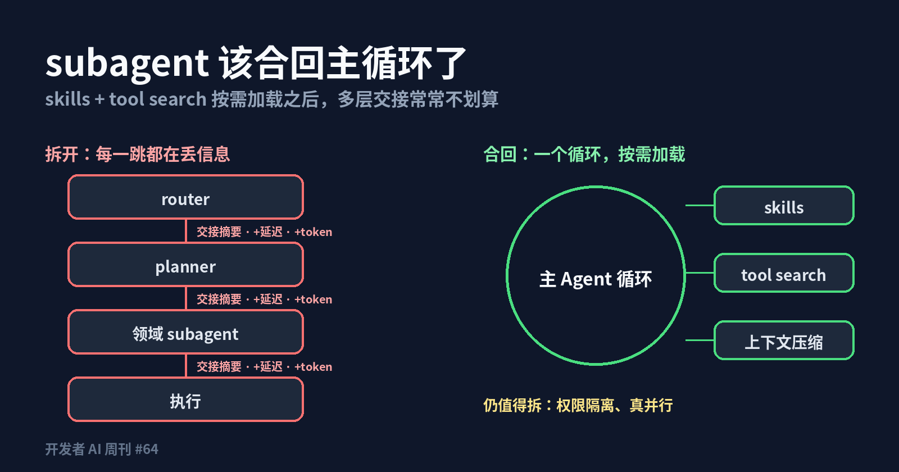

这时多层交接带来的信息损耗、额外 token 和延迟，往往比它省下的上下文更贵。主循环看得到完整对话，也就不需要别人替它转述用户到底想要什么。

例子不止一个。LangChain 总结的[公司 harness 五个组件](https://www.langchain.com/blog/components-building-company-harness)里，核心是一个带沙箱、凭证和记忆的执行环境，而不是一棵 Agent 树。

AI21 给 GitLab Duo 做代码评审，降本靠的也不是再加一层分工，而是换小模型加上下文压缩。每个 PR 的成本从 $0.589 降到 $0.0135，降了约 98%。

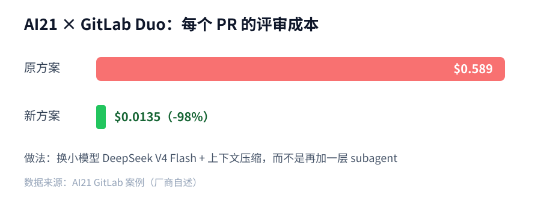

保留意见也要说清楚。subagent 仍有两个站得住的理由：一是权限隔离，读不可信网页的那个 Agent 不该同时拿着生产密钥；二是真正的并行，十个互不依赖的检索任务分出去跑，墙钟时间确实能省下来。

另外，上面的数字多是厂商自述，换到你的任务上要自己再测。合并之后主循环的上下文会变长，缓存命中和压缩策略也得跟着调整。

我的判断是：拆 subagent 应该是为了隔离和并行，而不是为了装下知识。手头已有多层架构的团队，先盘点哪些层只做「转发」，比如只判断意图的 router、只把任务改写一遍的 planner。

把这些层并回主循环，领域知识改成 skills 按需加载。合并前后用同一组 eval 比较成功率、每任务成本和延迟，数字说话再决定下一层要不要动。

## 本周快讯

- [GPT-6.1 Terra](https://openai.com/index/introducing-gpt-6-1-terra/) OpenAI 新的快档模型，视觉推理、computer use 与编码一起加强，API 每百万 token 输入 1 美元、输出 5 美元。
- [Kimi K3.1 Pro](https://www.kimi.ai/blog/kimi-k3-1-pro) API 已上线，承诺 11 月 4 日前开放权重，Artificial Analysis 得分 55。
- [Recursive Flint](https://recursive.com/updates/introducing-recursive-flint) 40B 总参、2.5B 激活的 MoE，主打在本地硬件上快速做 Agent 编码。
- [前沿模型上 Google Cloud](https://openai.com/index/openai-models-google-cloud/) OpenAI 模型与 Codex 工作流进入 Vertex Model Garden，同周 [Claude Platform 也全量上了 Google Cloud](https://claude.com/resources/articles/claude-models-on-google-cloud-anthropic-managed)。
- [Agent Skills 捐给 AAIF](https://www.anthropic.com/news/donating-agent-skills-to-the-agentic-ai-foundation) Anthropic 把 Skills 标准交给 Linux 基金会下的 Agentic AI Foundation 中立治理。
- [Cursor 能控制电脑](https://x.com/cursor_ai/status/2113661506634305834) Agent 可以驱动 iOS 模拟器等桌面应用，自己点一遍刚写的功能。
- [LiteLLM 投毒](https://docs.litellm.ai/blog/security-incident-oct-21-2026) v1.107.0 恶意包在 PyPI 上存活约 2 小时，用户应立即核对锁文件版本。
- [Workers AI 串数据](https://blog.cloudflare.com/kv-cache-exposure-remediation/) KV cache 容量不匹配加 SGLang 缺陷，导致 155 条 GLM-5.3 响应带出了其他客户的数据。
- [Claude 文本水印](https://www.oreilly.com/radar/the-latest-anthropic-claude-models-contain-ai-text-watermarks-what-does-this-mean-for-you) 为合规 EU AI Act，新模型基于 SynthID-Text 在近义词选择上做偏置。
- [Railway 安全披露](https://blog.railway.com/p/security-disclosure-wednesday-october-21st) 客户环境变量可能被未授权访问，部署在 Railway 上的项目应尽快轮换密钥。
- [Claude Duet](https://claude.com/resources/articles/claude-duet) Anthropic 的主动式个人 Agent 研究预览，监控已连接应用、排优先级，需要时再请求批准。
- [Next.js 安全发布预告](https://nextjs.org/blog/upcoming-nextjs-security-release-november-2026) 11 月 3 日将修复 7 个中危漏洞，可以先把升级排进日程。

## 技术文章

### [何时把 subagent 合回主循环](https://claude.com/resources/articles/building-agents-when-to-fold-subagents-into-your-main-agent-loop)

Anthropic 讨论 router、planner、领域专家这类 subagent 什么时候该并回单个 Agent 循环。

Key insight：skills 与 tool search 让上下文可以按需加载，拆分的主要收益消失了，交接摘要的信息损耗、额外 token 和延迟却还在。

落地建议：盘点现有多层架构，先合并只做转发的 router 或 planner，用同一组 eval 对比合并前后的成功率与每任务成本。

### [搭「公司 harness」的五个组件](https://www.langchain.com/blog/components-building-company-harness)

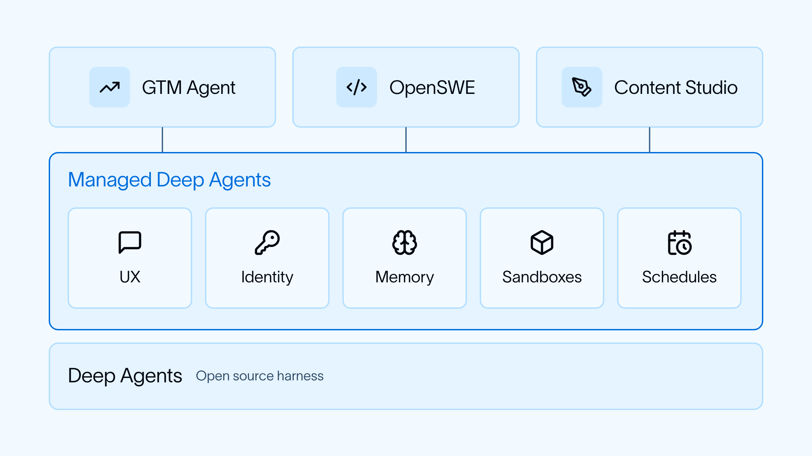

LangChain 总结在公司内部搭 Agent 平台需要的五个组件。

五项分别是：Slack 等入口、限定范围的凭证、共享与个人记忆、沙箱执行，以及定时运行。

落地建议：做内部 Agent 平台的团队，可以按这五项自查缺哪块，凭证和沙箱优先补齐。

### [GitLab Duo 代码评审成本砍掉 98%](https://www.ai21.com/blog/gitlab-case-study/)

AI21 分享为 GitLab Duo 优化代码评审的案例，做法是换模型加压缩上下文，而不是加更多 Agent。

换成 DeepSeek V4 Flash 并做上下文压缩后，每个 PR 的评审成本从 $0.589 降到 $0.0135。这是厂商自述数据，质量对比要看原文细节。

落地建议：已上 AI 评审的团队，先按「每 PR 成本」记账，再拿一批历史 PR 试小模型加压缩的组合。

### [修好 vLLM 的工具调用准确率](https://www.ubicloud.com/blog/fixing-tool-call-accuracy-in-vllm)

Ubicloud 排查了开放模型经 vLLM 部署后工具调用不稳定的问题。

Kimi K2.6 经 vLLM 默认只有 92% 的调用符合 schema，打开约束解码后拉到 100%。对 Agent 来说，8% 的格式错误足以让长任务中途崩掉。

落地建议：自托管开放模型做 Agent 时，默认开启 structured output 或 guided decoding，并把 schema 通过率纳入上线检查。

### [用 Agent 排查线上问题](https://getstream.io/blog/ai-agent-production-investigation/)

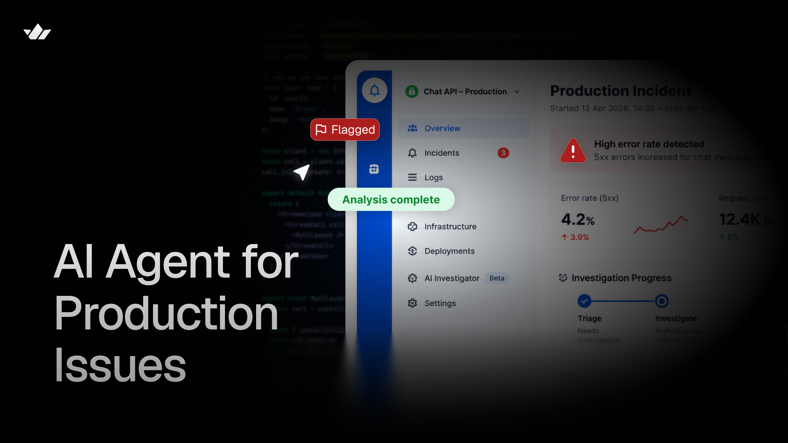

Stream 介绍他们用 Agent 做线上故障调查的流程。

Agent 先收集日志、指标、SQL 查询结果和相关代码，得出结论后再另开一个会话反驳自己，结论站得住才发到频道里。

落地建议：做值班 Agent 的团队，在发结论前加一步「新会话质疑」，用来压低误报，再考虑扩大权限。

### [LLM 让大规模形式化验证变得可行](https://www.anthropic.com/research/formal-verification)

Anthropic 研究用 Claude 给开源库自动生成可被机器检验的证明。

Key insight：已有的 fuzz 测试其实就是规格。Claude 为 123 个开源库的 239 个 fuzz 入口生成了证明，把测试升级成形式化保证。

落地建议：维护底层解析、编解码库的团队，可以先挑一个已有 fuzz 入口试，证明失败的地方往往就是值得看的边界。

### [如何评估主观任务上的 Agent](https://cameronrwolfe.substack.com/p/subjective-evals)

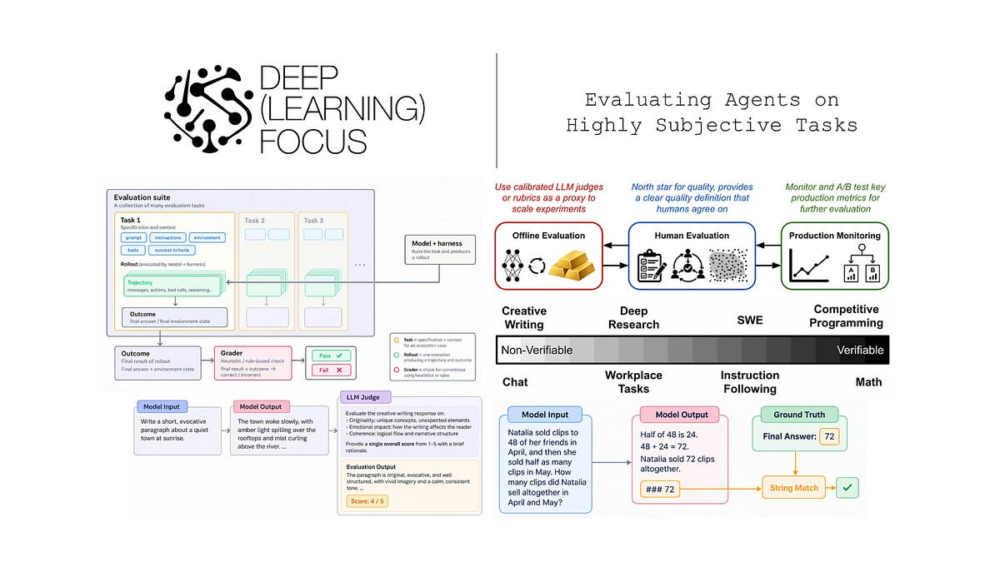

Cameron Wolfe 长文讨论写作、设计这类没有标准答案的任务该怎么评估。

方法是三者结合：校准过的人工判断、自动评审加 rubric、线上监控，并讲了功效分析与置信区间怎么算。

落地建议：做主观类 Agent 的团队，先用功效分析算清需要多少样本，再比较两个版本，别凭十几个样本下结论。

### [编码 Agent 需要怎样的 CLI 报错](https://debuff.jp/research/what-agents-need-from-cli-failures)

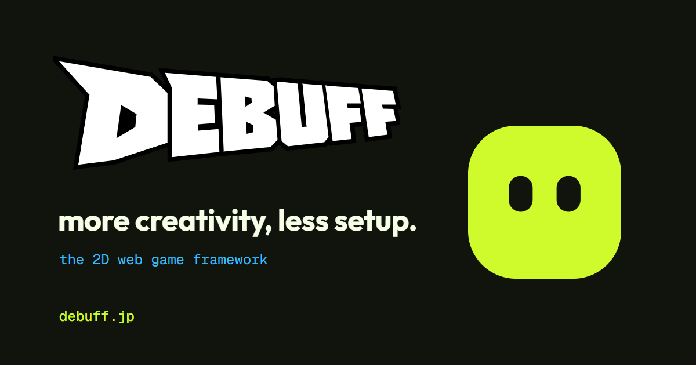

这篇研究对比了 12 个 JS CLI 在失败时给编码 Agent 的信息。

结论是 Agent 需要有区分度的退出码、结构化的失败信息，以及明确的重试指引；只打印一段人读的报错，Agent 常常会盲目重试。

落地建议：维护 CLI 的团队，先加一个 `--json` 错误输出和稳定的错误码，成本很低，Agent 用起来立刻少绕弯。

### [Agent 时代的 Pure UI](https://mattrothenberg.com/notes/pure-ui-agentic-era/)

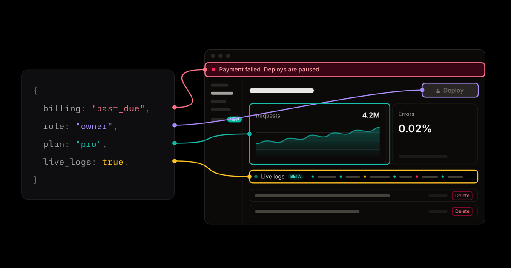

Matt Rothenberg 重提 Pure UI：把界面写成状态的纯函数。

把角色、套餐、账单状态、feature flag 这些维度显式化后，人和 Agent 都能在合并前一次性检查所有组合，而不是靠手点。

落地建议：给关键页面做一个状态矩阵预览页，让编码 Agent 改完 UI 后先截图过一遍矩阵。

### [GrokBot 很好用，但我停用了](https://www.builder.io/blog/grokbot-review)

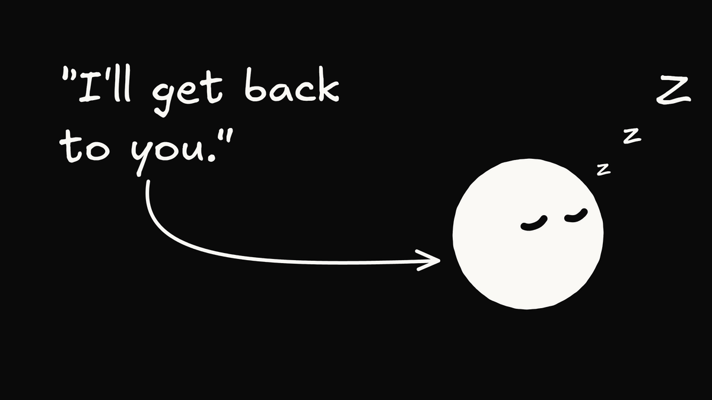

Builder.io 记录了一次常驻 Agent 的实验：16 个 bot 一周合并了 78 个 PR。

问题出在成本：一个周末里大量无效唤醒就烧掉约 100 美元，最终作者选择停用。

落地建议：上常驻 Agent 前，先给唤醒条件设门槛、给每天设预算上限，按「每个合并 PR 的成本」评估是否值得。

## 工具推荐

### [GitHub Agentic Workflows](https://github.github.com/gh-aw/)

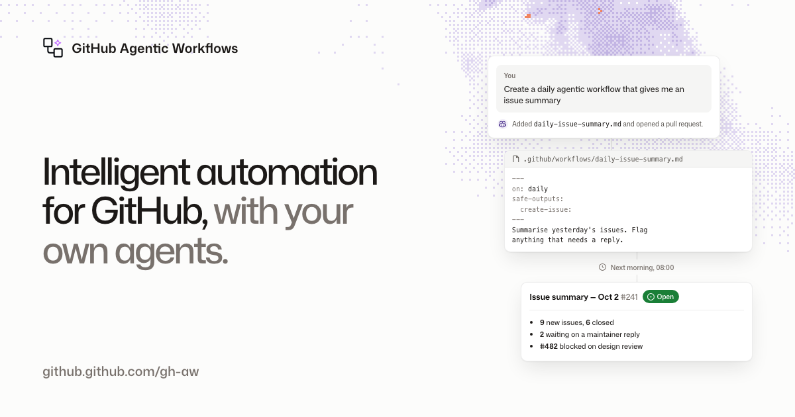

GitHub 推出的 gh-aw，用 Markdown 写工作流，编译成 GitHub Actions，让 Copilot、Claude、Codex 等编码 Agent 定时或按事件做 issue 分诊、排查 CI 失败、开 PR。

安全上号称六层纵深防御，包括隔离沙箱、凭证隔离、不可信内容过滤、Agent 防火墙、威胁检测和 safe outputs：只有声明过的写操作，由单独的 job 用自己的权限执行。成本可用 `max-ai-credits` 给每次运行设上限。

落地建议：先在一个仓库开 `staged: true` 预览所有输出而不真正写入，挑 CI Doctor 或 Repo Status 这类现成工作流试一周再放开。

### [TanStack AI 1.0](https://tanstack.com/blog/tanstack-ai-1-0)

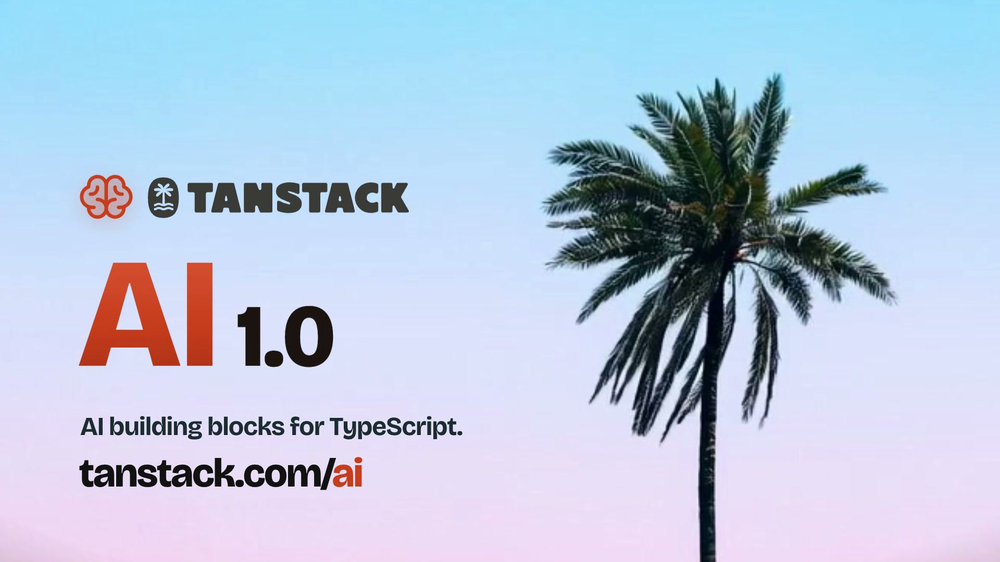

TanStack AI 发布 1.0，76 个包进入稳定 API。

覆盖聊天、工具调用、媒体、MCP、持久化与沙箱，不绑定模型厂商，也不绑定前端框架。

落地建议：不想被单一 AI SDK 锁定的前端团队，可以在一个新功能里试，先验证工具调用与流式 UI 的体验。

### [Expo Agent CLI](https://expo.dev/blog/introducing-expo-agent-cli)

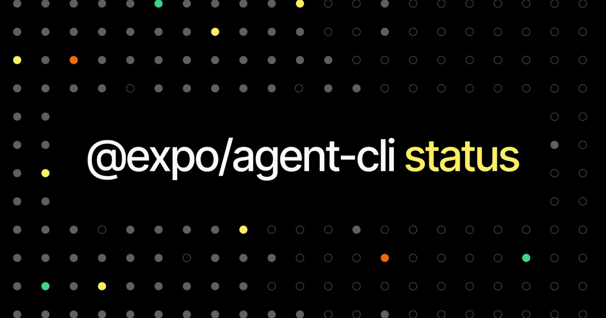

Expo 推出实验性的 Agent CLI，专门给编码 Agent 用。

它帮 Agent 选对构建方式、启动 App 并做冒烟测试，输出是结构化的，Agent 能直接判断成功与否。

落地建议：Expo 项目可以把它加进 Agent 的验证步骤，要求每次改动先过一遍冒烟测试再提 PR。

### [NVIDIA OpenShell](https://github.com/NVIDIA/OpenShell)

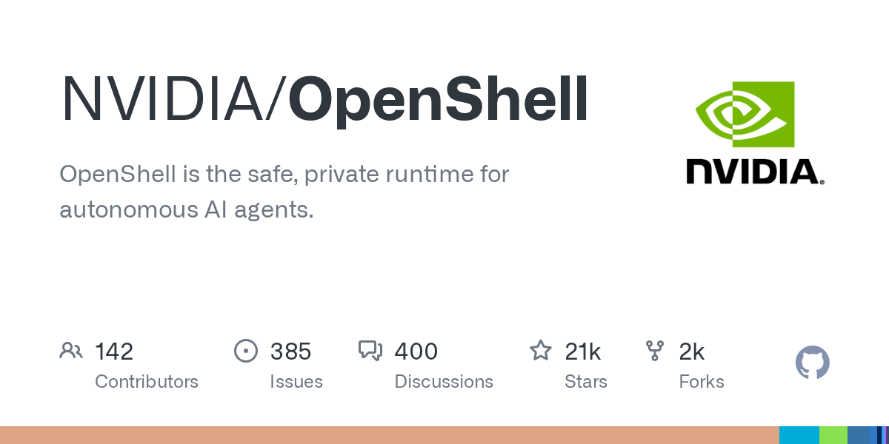

NVIDIA 开源的 Agent 沙箱运行时，让 Agent 在策略控制下执行命令。

它做内核级的文件与网络限制，凭证由运行时注入而不交给模型，权限变更还有形式化检查。

落地建议：给能跑 shell 的 Agent 换上它之前，先写好网络白名单和可写目录，从最小权限起步。

### [JetBrains ThinkRail](https://github.com/JetBrains/thinkrail)

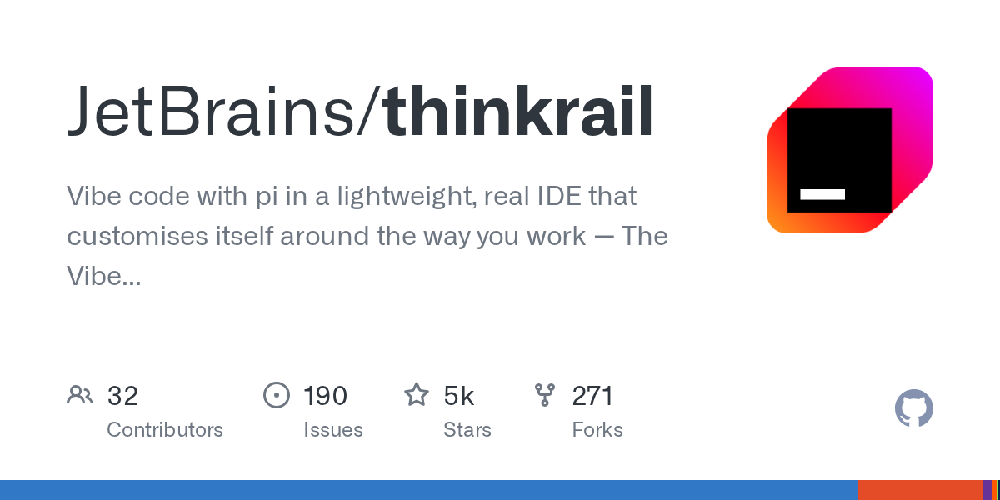

JetBrains 开源项目，把 pi 编码 Agent 包进 IDE。

每个并行任务用独立的 Git worktree 隔离，配合 SPEC.md 描述需求和可复用的 skills。

落地建议：习惯同时开多个 Agent 任务的开发者，可以试这套 worktree 隔离，避免几个任务互相踩文件。

### [1Password for Agents](https://1password.com/blog/1password-for-ai-agents)

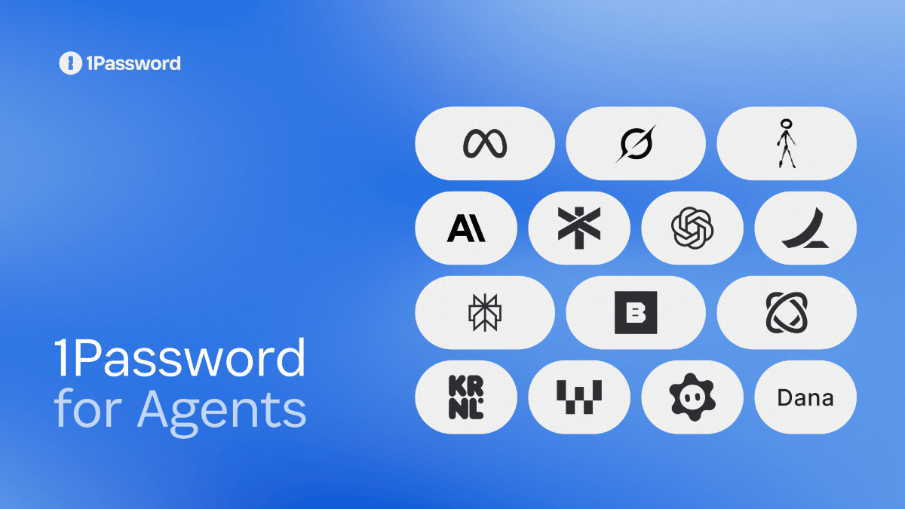

1Password 推出面向 AI Agent 的凭证方案。

用户批准后，由 1Password 直接把凭证填进目标站点，模型全程看不到密码，也就不会出现在日志和上下文里。

落地建议：让浏览器 Agent 登录业务系统的团队，优先接这类凭证代理，别把密码写进提示词或环境变量。

### [Cloudflare Computer v0.7.0](https://developers.cloudflare.com/changelog/post/2026-10-26-computer-durable-javascript/)

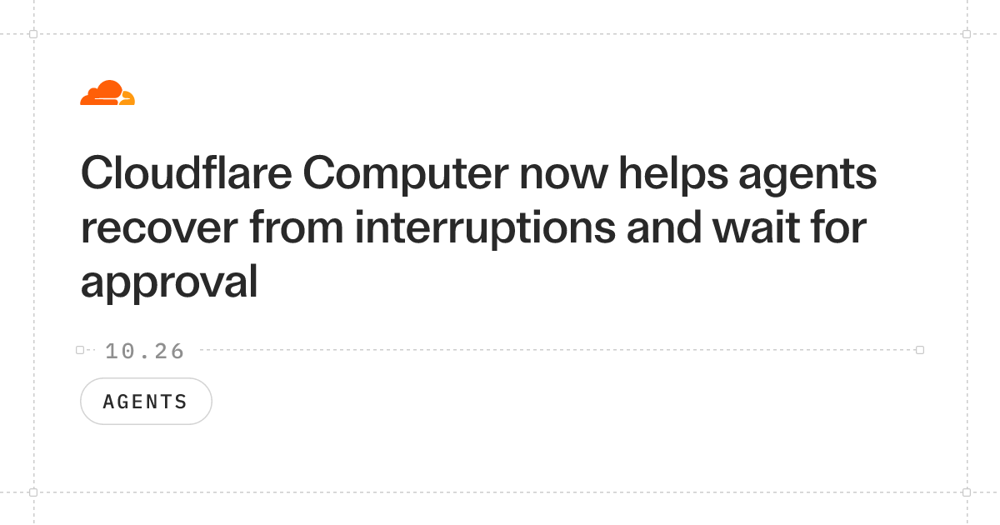

Cloudflare Computer 发布 v0.7.0，加入可持久化的 JavaScript 执行。

Agent 代码在重新部署或崩溃后可以接着跑，还能暂停等待外部审批，审批通过再继续。

落地建议：需要人工确认的长任务，可以用它代替自己手写状态机，先拿一个审批流做试点。

### [OpenAI CLI](https://github.com/openai/openai-cli)

OpenAI 发布官方命令行工具，直接在终端调用 OpenAI API。

对脚本和 CI 来说，它省掉了手拼 curl 请求和处理鉴权头的胶水代码，命令也更容易让编码 Agent 调用。

落地建议：CI 里有调 OpenAI API 的脚本，可以挑一个换成官方 CLI，确认密钥仍只从 CI secret 注入。

### [Discourse 提供 Markdown 端点](https://blog.discourse.org/2026/10/markdown-endpoints-your-community-in-a-format-that-ai-agents-can-read/)

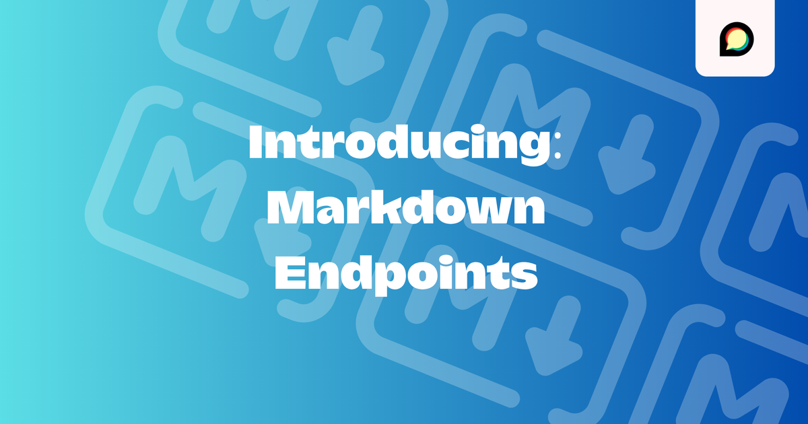

Discourse 社区现在可以直接给 Agent 返回 Markdown。

URL 后加 `.md`，或在请求里带 `Accept: text/markdown`，就能拿到处理好的 Markdown，省掉解析 HTML。

落地建议：自己的文档站或社区也可以照做一个 `.md` 版本，方便 Agent 读取，也能减少 token 浪费。
