## 卷首：Agent 记忆要靠睡后整理

很多团队给 Agent 加记忆，第一步就是把对话日志和笔记塞进向量库。下一轮能搜到的东西变多了，写错过的旧笔记也会被反复读到。

跨会话的 Agent 不能指望上一轮上下文还在。窗口一关，模型下一轮只能看到你事先留下来的东西。

光把材料存下来还不够，还要在空闲时把它们整理成以后真用得上的笔记。

Anthropic 这周发了 [The Components of Agent Memory](https://www.anthropic.com/research/components-of-agent-memory)。他们把记忆拆成两步：会话进行时当场记下要点，空闲时再离线整理，后一步叫 dreaming。

做法来自 Letta 和 UC Berkeley 提出的 sleep-time compute。模型利用两次交互之间的空档，回看日志、改正错误、写下新笔记。

他们用 Stainless 被收购前约 35 万份内部文件、约 4.2 亿 token 做评测，共 25 道题。用 dreaming 从 2 个会话做到 128 个会话，只靠 wiki 答题的得分从 13% 升到 48%。

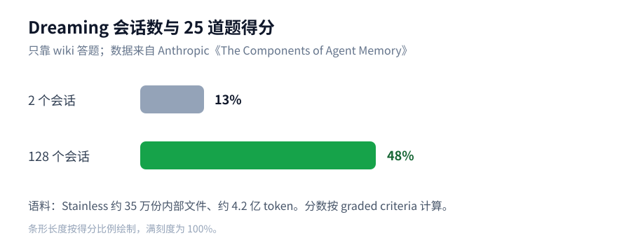

wiki 和搜索一起用时，分数随 wiki 变厚从 54% 升到 61%，只用搜索是 53%。只靠 wiki 的最好成绩是 48%，每道题少用约 2 万 token。

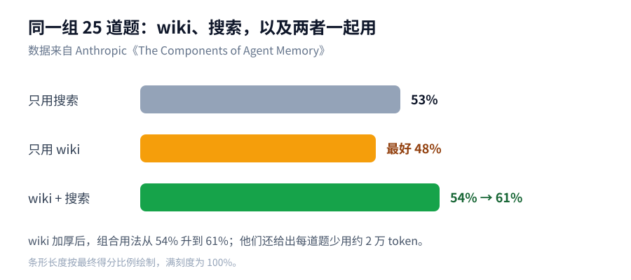

整理本身也会写错。在一份法律简报任务里，多个 Agent 同时改同一张合同条款表，57 条事实一开始只写进了 41 条，漏了 28%。

后来改成每个合同由一个 Agent 负责、按原文摘录，57 条才全部写上。有一次 wiki 甚至写得比原始文件还长，等于没有抽象。

LoreKit 同周写了 [呼吁统一 Agent 记忆格式](https://www.lorekit.io/blog/open-agent-memory-format)。现在的 AGENTS.md、Anthropic 的 /memories、Copilot 记忆和 MCP 知识图谱互不相通，一条经验写在一个工具里，换一个工具就读不到。

Dreaming 要额外花计算。记错的规则如果不改，会被带进之后每一次会话。

Anthropic 也写了：注入的记忆会占上下文，错的笔记会被反复加载。Claude Code 的 MEMORY.md 只预加载前 200 行或 25 KB，就是为了把注入层压小。

我没跑过这组评测，但 13% 到 48% 的差距够说明：整理要单独做，不能指望只靠向量检索就得到结构清晰的记忆。

我赞成先加一个空闲时整理日志的任务，而不是一上来上向量库。整理时要能对照原始会话改错，不要只做摘要。

如果团队同时用 Claude Code、Cursor 和 CI Agent，先约定一个仓库内的记忆位置，比如 AGENTS.md，避免同一条经验散落在四处。错的记忆要能被覆盖或标记过期，不然睡后整理只会把错误写得更整齐。

## 本周快讯

- [Claude Fable 5.2 / Mythos 5.2 发布](https://www.anthropic.com/claude-fable-and-mythos-5-2) 同一底座两个版本，Fable 带网安和生物防护、面向所有用户；输出比 5.1 快最多 30%，价格降到输入 $8 / 输出 $40 每百万 token。
- [Gemini 4 Carbon 开放 API](https://blog.google/innovation-and-ai/models-and-research/gemini-models/gemini-4-carbon-now-available/) 付费开发者可用，首发价与 Gemini 4 Argon 相同（$2 / $10 每百万 token，11 月 30 日后涨到 $4 / $20），GitHub Copilot 同日接入。
- [Meta Muse Ember](https://research.meta.ai/blog/muse-ember) Meta 最小的推理模型，主打工具调用、编码子任务、路由与抽取；已在 Meta Model API 上线，价格 $0.10 / $0.50 每百万 token，自称能追平 Claude Haiku 5.5 的最佳分数，每任务成本约三分之一。
- [Inkling 2 Small](https://thinkingmachines.ai/news/inkling-2-small/) Thinking Machines 发布 594B 总参、17B 激活的 MoE，支持图像输入与可调推理档位，目前先在 Tinker 上提供。
- [Cursor 可直接构建并分享线上应用](https://cursor.com/changelog/build-live-apps) 云端 Agent 能建应用、配数据库和鉴权、跑安全检查并部署，再用链接分享给同事。
- [Cursor 与 Agent 实时语音通话](https://cursor.com/changelog/voice-chat) 在 Agents 窗口、IDE、网页和 iOS 上可以和 Agent 语音对话、听进度。
- [Claude Code 2.1.321](https://raw.githubusercontent.com/anthropics/claude-code/main/CHANGELOG.md) 把 Claude Fable 5.2 设为默认 Fable 模型，并修复 MCP OAuth 重定向时把 refresh token 发到别的主机、只读 Bash 命令绕开沙箱不提示等问题。
- [GitHub 秘密扫描覆盖 Actions 日志](https://github.blog/changelog/2026-11-09-secret-scanning-detects-secrets-in-github-actions-workflow-logs/) workflow 日志里泄漏的密钥也会被检出；目前是公测，需企业开启，默认关闭，开启前的旧日志不会回扫。
- [Fireworks 安全事件波及 Notion](https://www.notion.com/help/security-incident-involving-a-third-party-ai-vendor) Fireworks 10 月内部凭证被滥用后，Notion 称影响不到 1% 的工作区，并已断开该供应商。
- [社区测试：Opus 5.5 推理模式 11-03 后有变化](https://threadreaderapp.com/thread/2119192075505893695.html) 有用户对比发现，思考过程的样式在 11 月 3 日前后明显不同。
- [Apple 被曝在做本地推理应用 Harbor](https://9to5mac.com/2026/11/10/apple-has-new-mac-app-coming-to-make-running-local-ai-models-easy/) 爆料称它能把一台或多台 Mac 变成私有推理服务器，尚未官宣。
- [美联航禁止 AI Agent 代订机票](https://www.cbsnews.com/news/united-airlines-bans-ai-agents-booking-flights/) 航司开始在条款里拒绝 Agent 代用户下单。
- [Val Town 宣布关停](https://blog.val.town/winding-down) 即日起停止计费，12 月 10 日进入只读，2027 年 1 月 10 日关停其余服务，并提供迁到 Cloudflare、Vercel、Netlify、Render 的指南。

## 技术文章

### [Agent 记忆的组成：当场记录与睡后整理](https://www.anthropic.com/research/components-of-agent-memory)

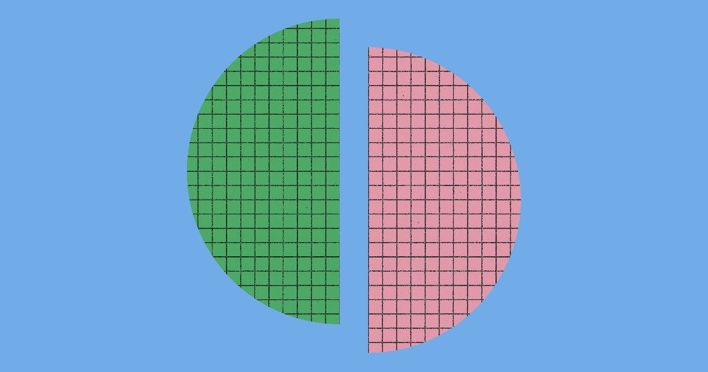

Anthropic 把 Agent 记忆拆成当场记录和离线整理（dreaming）。卷首写过 dreaming 的主评测数字，这里补两点工程约束。

玩 Pokémon 时，Sonnet 3.7 写了 413 个记忆文件，Fable 5 只留 9 个文件加一份 `global.md`。Claude Code 的 MEMORY.md 也只预加载前 200 行或 25 KB，当作目录而不是全文灌入。

落地建议：给长期跑的 Agent 加一个空闲任务，对照原始会话日志改正已有笔记，而不是只追加新摘要。

### [呼吁统一 Agent 记忆格式](https://www.lorekit.io/blog/open-agent-memory-format)

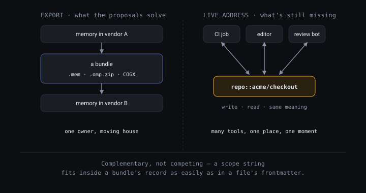

LoreKit 指出 AGENTS.md、/memories、Copilot 记忆和 MCP 知识图谱互不相通，并呼吁一份共用的记忆规格。

现有方案多在解决「从厂商 A 导出到厂商 B」。CI Agent、编辑器 Agent 和审查机器人要同时读写同一个地址，这一层还缺约定。

落地建议：先在仓库里定一个记忆落点（例如 AGENTS.md），新加工具写入前先读这个位置。

### [AWS Emulator 与 Agent 写代码时工程师干什么](https://www.allthingsdistributed.com/2026/11/aws-emulator-and-the-engineers-job-when-agents-write-the-code.html)

Swaminathan Sivasubramanian 在 Werner Vogels 博客里介绍 AWS Emulator 怎么来的：给 Agent 一份服务该怎么表现的说明，再拿真服务做对照。

做法是按公开 API 模型写出 fidelity tests，先让测试对着真 AWS 通过，再让模拟器通过同一组测试。仓库里 200 多个服务、400 多份 API 模型的代码都由 Agent 编写，许可证是 CC0。

落地建议：给内部服务先写一组能对照真环境跑通的 fidelity tests，再让 Agent 按这组测试生成本地 mock。

### [Amazon 用 Strands Decider 替换 Sonnet 4.6 打工单标签](https://strandsagents.com/blog/amazon-saves-millions-replacing-sonnet-with-strands-decider/)

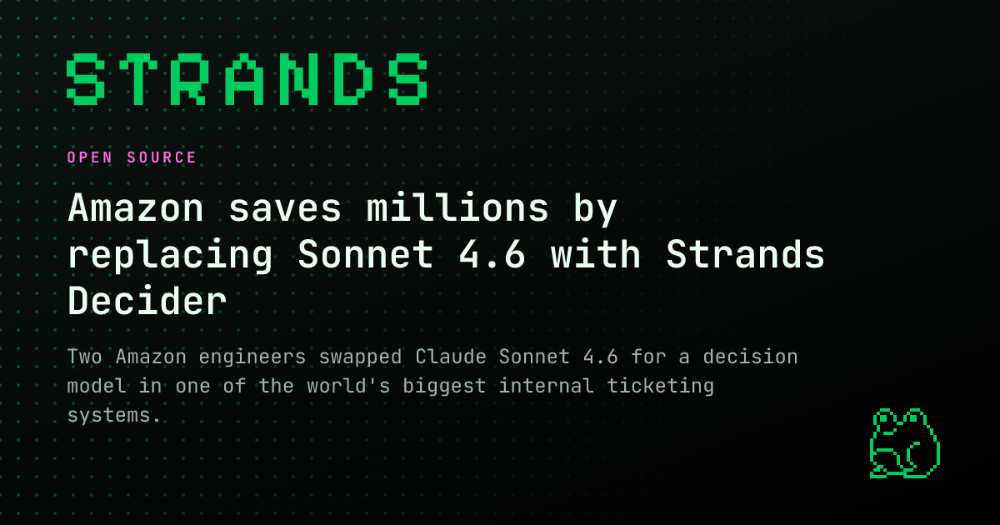

Amazon 内部工单系统把 Claude Sonnet 4.6 换成决策模型 Strands Decider，用来打 20 类标签。#62 讲过这类决策模型，这里只记生产数据。

平均每次调用从 4,215ms 降到 897ms，每单总 token 从 6,724 降到 2,010，按标价估算成本降 98%（约 $0.0222 对 $0.0005）。

落地建议：固定选项的工单分类，用现有标注集并跑决策模型，看校准度和每单耗时。

### [JS 框架的 AI 成本](https://nolanlawson.com/2026/10/28/the-ai-cost-of-javascript-frameworks/)

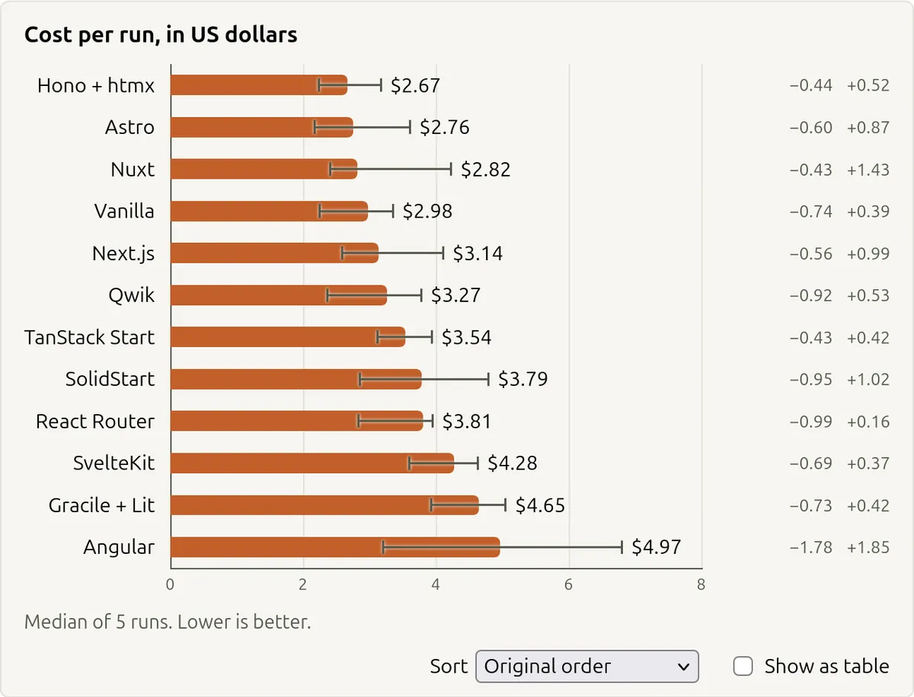

Nolan Lawson 让 Claude Code（Opus 5.5）用不同框架各做 5 次同一款 Pokémon 应用，比较费用、耗时和 token。

中位费用最低的是 Hono+htmx（$2.67）、Astro（$2.76）和 Nuxt（$2.82），Angular 最高（$4.97）。这只是一个偏内容型站点的样本。

落地建议：新项目如果主要靠 Agent 写前端，把「同一任务下各框架的 token 账单」列进选型表，但不要只看这一个样本。

### [3.5 万个 Grok 生成的应用对任何人公开](https://blog.claroc.io/ghostshares-grok-build-apps)

Claroc 测试了 37,571 个仍在线的 Grok 生成应用，其中 35,578 个（94.7%）无需登录即可打开，里边有员工内部资料。

他们还写到，在所用账号里点击发布时，默认建议的访问范围是「有链接的人都能打开」。

落地建议：做「一句话生成并发布应用」的产品，把默认访问权限改成私有，发布前强制确认分享范围。

### [ChatGPT 后续调用被静默路由到另一个连接器](https://community.openai.com/t/security-follow-up-tool-call-silently-routed-to-a-different-connector/1413053)

OpenAI 开发者社区有人报告：同一个对话开了两个连接器时，带一次性确认码的后续调用走了另一个连接器，用户不知情。

确认码如果只认码、不绑连接器身份，就可能把一个应用里的数据交到另一个 OAuth 客户端。报告者这边因为服务端做了绑定，调用被拒绝了。

落地建议：做 Apps SDK 连接器时，把一次性确认码绑到连接器的 OAuth 客户端身份上，不要只校验码本身。

### [Glasswing 七个月：发现多、修复少](https://www.vulncheck.com/blog/anthropic-glasswing-november-update)

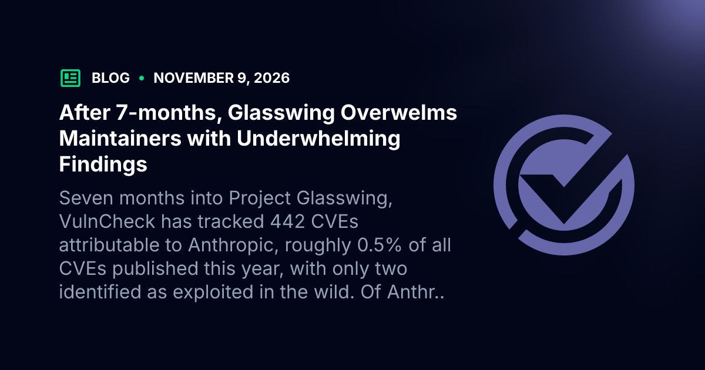

VulnCheck 追踪 Anthropic Project Glasswing 七个月后的数字：报出 37,966 个问题，公开 7,349 个，标记修复仅 217 个；归因 CVE 442 个，在野利用 2 个。

curl 维护者公开的 34 份报告里，19 份被标成不是漏洞，6 份确认为低危。发现可以自动化，分诊和修复仍然要人来做。

落地建议：用 AI 扫开源漏洞时，先定分诊和去重流程，再决定要不要把未人工复核的报告发给维护者。

### [Cloudflare 的 Agent 信任委托框架](https://blog.cloudflare.com/trusted-agent-delegation)

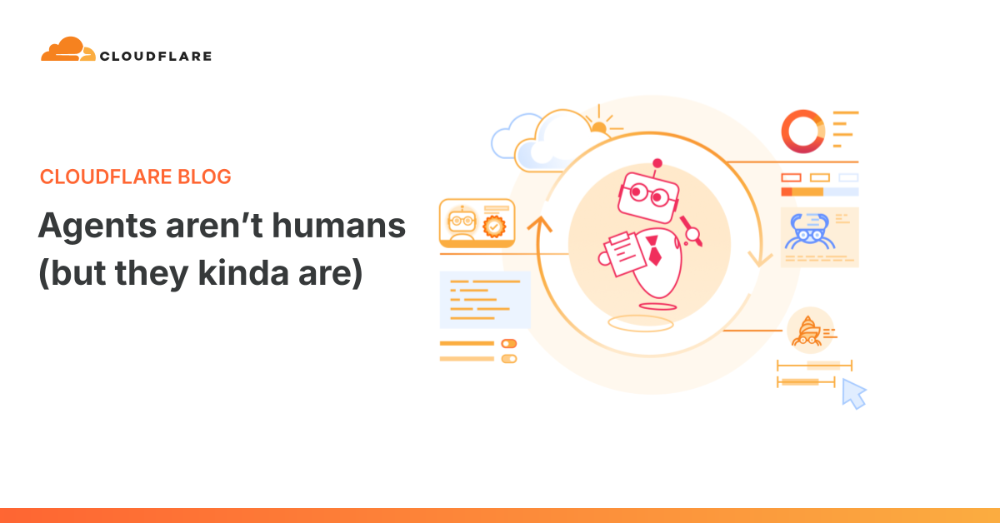

Cloudflare 讨论 Agent 代人上网时，网站往往只能看到 Agent，看不到背后的用户，因而难以识别、服务和追责。

他们把这件事拆成身份、信誉和问责，并开始在分析里单独列出个人助手流量，好把某个被滥用的账号和整个 Agent 服务分开处理。

落地建议：对 Agent 开放的网站，先设计「哪个用户委托了哪个 Agent」的识别方式，再谈限流和审计。

### [AI 让代码库变脆](https://evanxmerz.com/post/ai-usage-generates-a-fragile-codebase/)

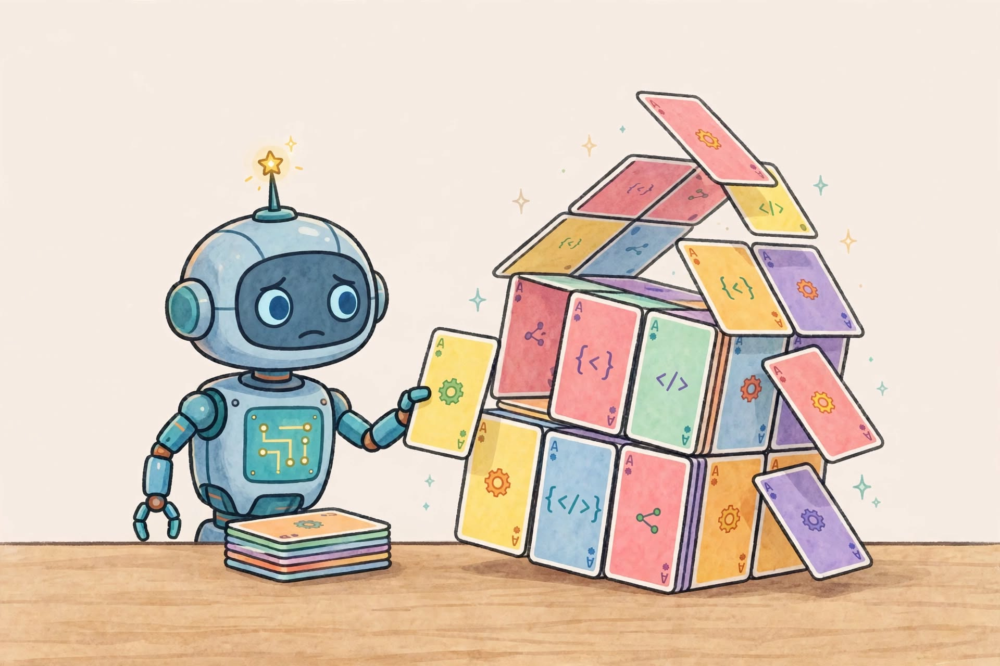

前 Meta 工程师 Evan X. Merz 写到，他一度用 AI 生成至少 90% 的代码，但产出并没有翻倍，重度依赖者写出的问题更隐蔽。

他列出的常见毛病包括测试只覆盖表面路径、代码拆得过碎、人对代码库越来越不熟，以及 PR 太快导致 review 只能扫一眼。

落地建议：把 AI 生成代码的 review 清单写进仓库，除了测试是否通过，还要查错误处理、边界条件和权限路径。

## 工具推荐

### [Gemini Decisions API](https://blog.google/innovation-and-ai/technology/developers-tools/gemini-decisions-api/)

Google 发布 Gemini Decisions API，由 Gemini Decision 1 一次前向打分，处理是非、选择和评分题。#62 讲过决策模型，这里记它的新接口。

官方数字是：上下文在 16K token 内时端到端 150–250ms，单次最多 1,000 个问题，输入 $0.10 / 百万 token，不收输出 token。

落地建议：已在用 OpenAI Decisions API 的分类或路由，用同一组标注并跑 Gemini Decision 1，对比校准误差和端到端延迟。

### [OpenRouter Auto / Auto Code 路由](https://openrouter.ai/blog/announcements/auto-and-auto-code-routers/)

OpenRouter 重写了 Auto 路由，并新加了面向编码工作的 Auto Code（`openrouter/auto-code`）。

他们给出的数字是：比旧版最高好 4 倍，p90 路由从 1.96s 降到 0.65s；beta 里无效工具调用降到四分之一。Auto Code 在五项评测上与 Claude Opus 5.5 接近，每任务成本低 74%。

落地建议：编码 Agent 把模型改成 `openrouter/auto-code`，用现有评测集对比固定 Opus 的每任务成本和通过率。

### [Antigravity /swarm](https://antigravity.google/docs/swarm/)

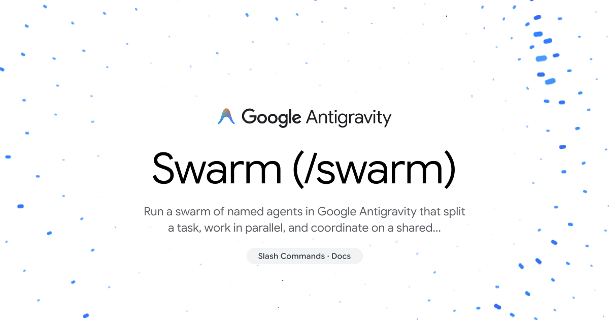

Google Antigravity 预览了 /swarm：协调者把任务拆给多个具名 worker，在共享消息板上协作，再由 verifier 审查测试。

Pro / Ultra 可用，配额消耗很快。

落地建议：只把能按文件或包干净拆开的任务交给 /swarm，并盯着配额消耗。

### [GitHub Next Ace](https://ace.githubnext.com/)

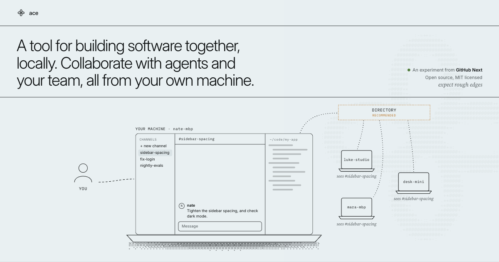

GitHub Next 的 Ace 让人在本地和队友、Agent 一起写代码。

每个工作单元是一个独立的 worktree 分支（lane），团队边界由 Tailscale 网络决定。

落地建议：多人多 Agent 并行改同一仓库时，先在一个小仓库里用 lane 试一轮冲突处理。

### [Devin Review 2.0](https://devin.ai/blog/devin-review-2)

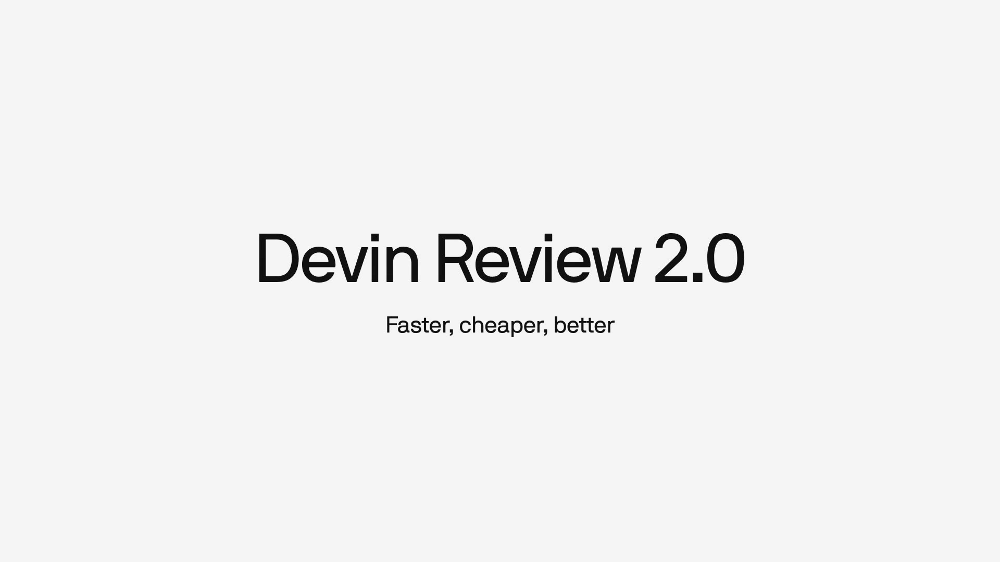

Cognition 发布 Devin Review 2.0，把自动审查一个 PR 的成本降到通常 $0.25–$0.75，比 8 月低 82%。

他们称每个 PR 找到的 bug 从 1.22 个升到 1.32 个，约 80% 的 PR（含多次推送）审查费用不到 1 美元。

落地建议：PR 量大、人工 review 成瓶颈的团队，按最近一个月的 PR 数乘 $0.25–$0.75 算一笔账，再决定是否默认跑自动审查。

### [ExecuTorch WebGPU](https://pytorch.org/blog/executorch-webgpu-pytorch-models-on-the-gpu-in-the-browser/)

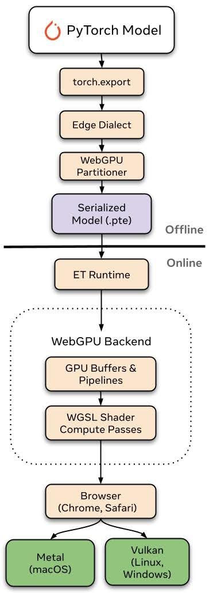

PyTorch 模型可以导出成 .pte，直接在支持 WebGPU 的浏览器里跑，不必先转成 GGUF 或 ONNX。

在 M1 Pro 的 Chrome 上，相比 ExecuTorch 的 Wasm（XNNPACK）路径，prefill 快 4–7 倍，decode 快 2–10 倍。

落地建议：要在浏览器本地跑 Whisper 或小 LLM 的，用同一模型各导出一条 Wasm 和 WebGPU 路径，对比 prefill 和 decode 耗时。

### [AWS Emulator](https://github.com/aws/aws-emulator)

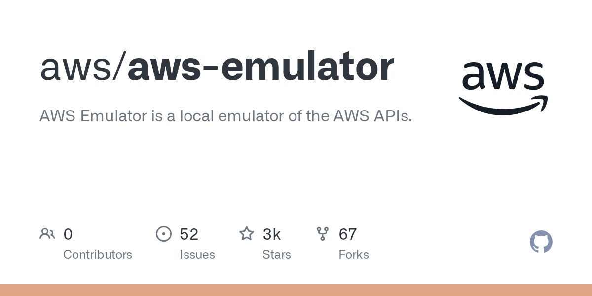

AWS Emulator 在本地模拟 AWS API，不需要 AWS 账号，可用于本地和 CI，代码以 CC0 发布。

仓库里有一个 `things-that-do-not-work` 目录，记录目前还对不齐真环境的行为。上文文章卡写了它怎么被造出来，这里只补怎么用。

落地建议：让编码 Agent 在 CI 里对 AWS Emulator 跑集成测试，先查 `things-that-do-not-work`，确认你用到的 API 已经覆盖。

### [Vercel Sandbox 快照提速 10 倍](https://vercel.com/changelog/vercel-sandbox-snapshot-creation-is-now-up-to-10x-faster)

Vercel Sandbox 创建快照的中位时间从 4.4s 降到 0.4s 以内，恢复的 p50 从 500ms 降到 250ms。

持久沙箱会在会话停止时自动打快照，新快照默认走新格式，旧快照仍用原格式。

落地建议：Agent 需要频繁回滚环境的流程，把「任务关键节点打快照」写进 harness，用新的 0.4s 中位耗时评估能否更密集地回滚。

### [Modern Web Guidance](https://github.com/GoogleChrome/modern-web-guidance)

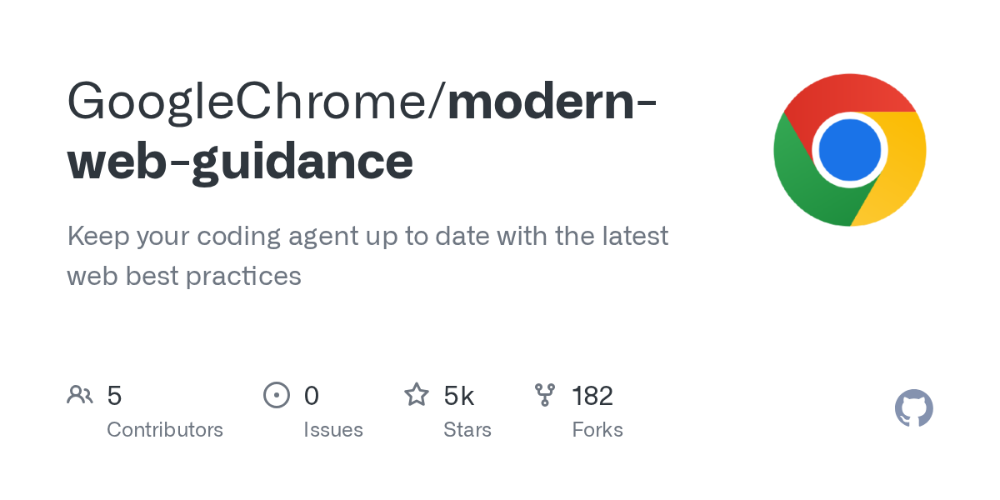

Chrome 团队给编码 Agent 写了一组 skills，带上浏览器兼容数据，帮 Agent 少写过时的 JS 写法。

支持 Claude、Codex、Cursor、Gemini 等插件格式。

落地建议：在前端仓库装上这套 skills，抽查 Agent 新写的代码是否还在用已过时的 API 或多余 polyfill。

### [Stroq](https://github.com/AGGIB/Stroq)

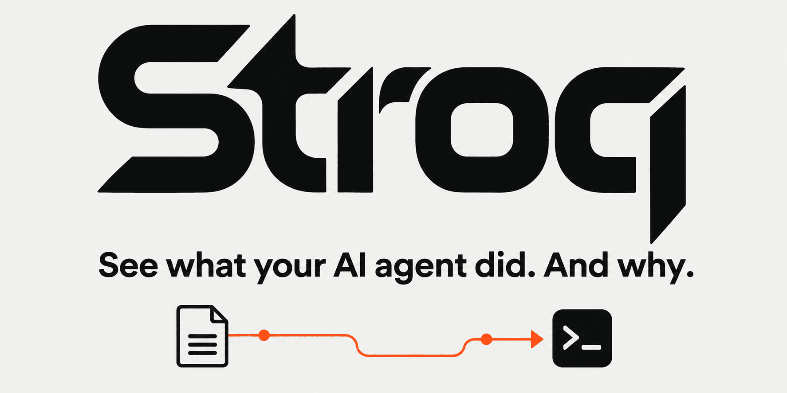

Stroq 扫描 Claude Code、Codex、Cursor 会话记录里的已知密钥，并用本地 hook 把危险命令追溯到触发它的内容。

开源，无遥测。

落地建议：跑过大量 Agent 会话的机器，先用 Stroq 扫一遍历史记录里的密钥，再把 hook 接到日常命令拦截上。

### [Firenook](https://firenook.dev/)

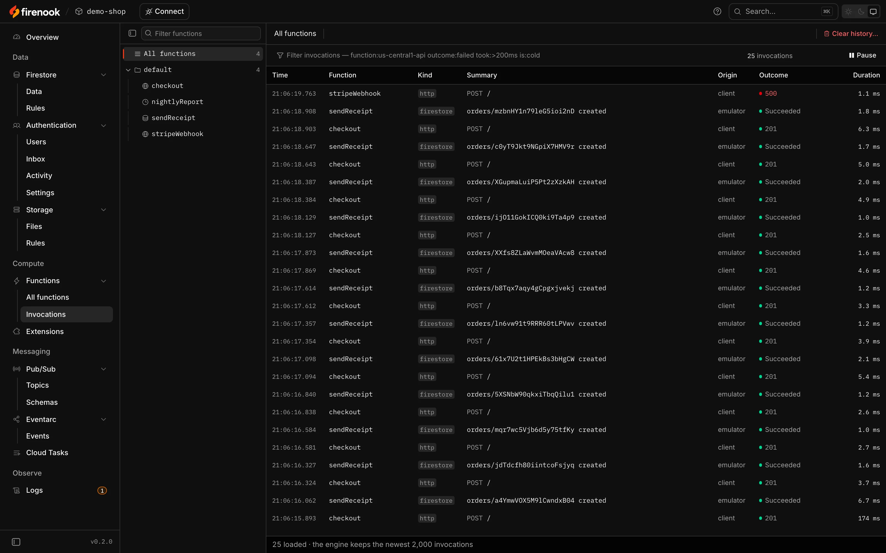

Firenook 是 Firebase 本地模拟器的替代品，保留 firebase.json、SDK 和端口，把启动命令换成它即可。

写入中位耗时 5.1ms 对 208.2ms，峰值内存 2.11 GiB 对 22.57 GiB。Realtime Database、Hosting 等服务尚未模拟。

落地建议：CI 里 Firebase 模拟器偏慢的项目，把 `firebase emulators:start` 换成 `firenook emulators:start`，用同一套测试看写入耗时和内存。
