## 卷首：先把代码读懂，再让 Agent 改得更快

Agent 一次交来几个 PR，测试全绿，摘要也写得清楚。评审的人却还没弄明白上一个改动为什么要挪走那段校验，下一个 PR 已经在新结构上加功能了。

这时候，合并次数还在涨，能解释系统为什么这样运行的人却越来越少。出了问题，大家先让 Agent 总结最近的提交，再让另一个 Agent 检查总结，原本该回到代码和运行结果上的核对，又变成了读一份生成文本。

Ryan Prior 在[这篇文章](https://www.ryanprior.com/posts/nyquist-limit-frequency-of-changes-in-tech-invalidates-understanding/)里，把这种处境比作触碰了奈奎斯特极限：系统变化得太快，人理解和评估它的速度跟不上，团队就可能把不完整的观察当成了真实状态。

他的提醒很有价值，但我不赞成把文章里的“两倍频率”直接变成团队规定。采样定理讨论的是满足带限等条件的信号，代码提交不是等间隔的波形，读一次代码也不是一个质量固定的采样点。

改一行文案和改一行权限判断，理解成本可能差得很远。读十遍自动摘要，也未必比沿着一次真实请求看清数据怎样经过校验、写入和返回更有效，不能据此推出“每天改五次，就必须读十次”的工程定律。

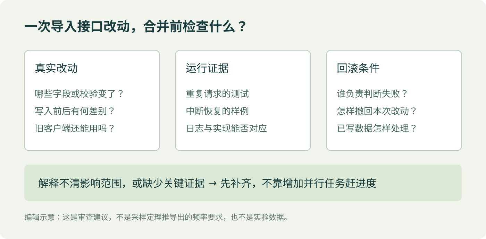

我更愿意把这个类比用来追问：团队有没有办法知道，哪些改动已经超出了自己能解释、能验证的范围？判断依据不是 PR 排队有多快，而是评审者能不能说清新行为在哪发生，哪些旧假设已经失效。

比如让 Agent 改一个导入接口。正常样例通过了，还要核对重复请求会不会写入两份数据，处理中断以后从哪里继续，以及旧客户端传来的字段是否仍然有效。

这些问题不必全靠人逐行找，但每个问题都该有可检查的证据。可以要求 PR 附上对应测试、失败样例和运行结果，评审者从接口入口跟到数据库写入处，确认实现与证据确实对应，而不是只看 Agent 写的说明。

如果一次改动同时换了数据结构、重写重试逻辑、又调整权限，先拆开提交。让评审者能单独判断每一步的行为变化，也让回滚不必连同无关功能一起撤掉，这比规定一个统一的每日合并上限更实际。

自动化当然可以扩大可验证的范围。稳定的端到端测试、属性测试和差异测试，能替人反复检查已经明确的约束，但测试全绿不代表需求正确，也不能替团队决定哪些行为根本不该发生。

没有人能解释影响范围、关键失败路径又没有证据的 PR，我会先挡住合并，而不是再开几个 Agent 帮它赶进度。先给这次改动找到责任人、补齐验证和回滚办法，确认读得懂、接得住，再提高并行度。

## 本周快讯

- [GPT-6.2 Astra / Sol 发布](https://openai.com/index/introducing-gpt-6-2-astra-sol) Astra 面向复杂专业任务，Sol 面向日常工作；官方在 FrontierCode 2.0 的 max 推理强度下测得，Sol 与 Astra 相差不到 0.5 分，每任务成本约为五分之一。
- [Gemini 4 Neon 发布](https://blog.google/innovation-and-ai/models-and-research/gemini-models/introducing-gemini-4-neon/) 提供 100 万 token 上下文，输入／输出每百万 token 为 3／15 美元；Google 称默认 high 推理强度在其引用的第三方评测中，每任务成本比 Carbon 低 32%。
- [Gemini 4 Hydrogen 补录](https://blog.google/innovation-and-ai/models-and-research/gemini-models/introducing-gemini-4-hydrogen/) 11 月 12 日首发、16 日更新，上期未收，支持 100 万 token 上下文，输入／输出每百万 token 为 1.50／7.50 美元，面向日常编码与 Agent 执行。
- [Qwen4-Max 发布](https://www.alibabacloud.com/en/press-room/alibaba-unveils-qwen4-max?_p_lc=1) 支持原生视觉和 100 万 token 上下文，阿里在内部 Work360 上测得，高推理强度下比 Qwen3.8-Max 少用 35% token、平均每任务成本降低约 60%，不代表所有业务都能得到同样降幅。
- [腾讯发布 Hy4 flash](https://www.tencent.com/tencent-launches-hy4-flash-to-power-high-speed-cost-efficient-ai-deployment-for-everyday-workflows/) 支持多模态输入与 100 万 token 上下文，官方内部 WorkIndex 的每任务成本为 Hy4 的二十分之一，但长程软件工程仍推荐使用 Hy4。
- [Microsoft Ignite 发布七款模型](https://microsoft.ai/news/microsoft-ignite-2026/) 其中 MAI Code 2 已进入 GitHub Copilot，微软在四项日常企业编码基准的平均结果中给出 GPT-6.1 Sol 的 98% 表现、约 40% 价格，明确尚未针对极长程 Agent 任务调优。
- [Responses API 增加后台完成窗口](https://developers.openai.com/api/docs/guides/background) 公测的 `2h`／`8h` 窗口在符合条件的 Standard 请求上分别降低 30%／40% 模型 token 费率，窗口针对初次响应而非整个多步任务，后台模式仍会临时保存响应数据。
- [Claude Code 2.1.328](https://code.claude.com/docs/en/changelog) 为第三方网关上的 Opus 4.6、Sonnet 4.6 开放 auto mode，并给自托管 runner 增加仓库目录选项、hook 标签和排队等待指标，升级前应核对默认权限模式变化。
- [ChatGPT Wallet 开始推出](https://openai.com/index/introducing-chatgpt-wallet) 首批面向美国年满 18 岁、持合格美国发行卡的 ChatGPT Pro 用户，通过 dots 使用，每次购物仍需确认商品、总额和卡片并完成安全验证。
- [Replit Agent 可代企业准备采购](https://replit.com/blog/replit-agent-ads-commerce) Core、Pro 的美国用户可用它完成一次性采购的选品和结账准备，扣款前须确认最终总额，审批检查由代码执行，不是只在提示词里要求模型停下。
- [Gemini Notebook 可生成交互站点](https://blog.google/innovation-and-ai/products/gemini-notebook/interactive-sites/) 用户可从已有资料生成可分享的解释页面、看板或任务跟踪页，网页端向年满 18 岁的用户逐步开放，也包括 Workspace 用户。

## 技术文章

### [换模型时，也要重新比较 Agent 执行框架](https://runta.com/blog/introducing-frontierharness-eval-v1-1/)

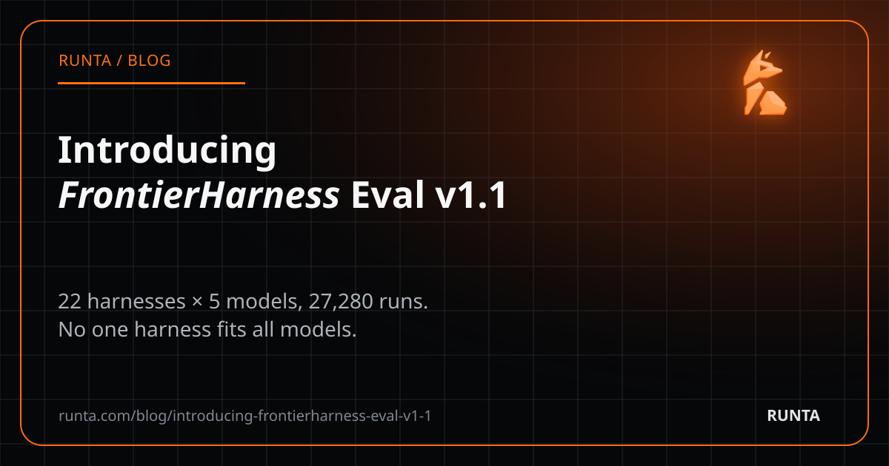

RUNTA 与 Baseten 用 18 个 Agent 执行框架（harness）的 22 种配置，搭配 5 个模型跑 62 项任务，每项各试 4 次。

评测共运行 27,280 次，固定模型后，每任务成本最高为最低的 1.8～5.0 倍；通过率的 95% 置信区间约为正负 10 个百分点，差几个点不能据此排出高下。

落地建议：换模型前，拿同一组私有任务重测两三个候选框架，同时记录每任务成本、每成功任务成本和通过率。

### [一直在线的 Agent，实际如何休眠和唤醒](https://claude.com/resources/articles/building-always-on-agents)

Anthropic 拆解了常驻 Agent 的运行方式：事件进来时唤醒，处理完保存状态，再回到休眠，并不是让模型持续空转。

事件收件箱、定时器、记忆、权限和发件箱负责衔接各次运行，持久化事件表还能记录处理状态，按来源 ID 去重，避免并发事件争用同一份会话状态。

落地建议：接新 webhook 前，先用按用户隔离的事件表，由单个 worker 顺序领取，验证崩溃后的重试。

### [Claude Code 团队怎样防止验证规则被改动绕过](https://claude.dev/blog/how-the-claude-code-team-thinks-about-verification/)

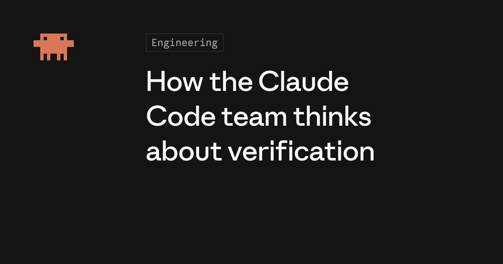

Addy Osmani 介绍 Claude Code 团队的验证流程，重点是端到端、属性和差异测试，让 Agent 用实际运行结果判断工作是否完成。

代码审查从基线或默认分支读取 `REVIEW.md`，不读 PR 改写的版本；“最多提高 10 个百分点”只来自结构化文件生成的内部测试。

落地建议：把 PR 的验收脚本从默认分支取出执行，给一条真实用户路径保存截图和日志，单独审查测试规则的变更。

### [全整数推理，能否让同一模型每次输出一致](https://nathan.rs/posts/detllm/)

DetLLM 用 Qwen3-0.6B 做概念验证，把从输入 token 到 logits 的前向运算全部改成整数，而不只是量化权重。

浮点加法顺序变化会影响舍入结果，整数方案在约束溢出和舍入规则后避免了这类差异；一致性保证绑定同一份转换产物，不代表任意模型都能直接无损替换。

落地建议：需要跨设备复现推理的团队，先跑它的逐位一致性测试，并单独比较转换后的质量和速度，不要把温度设零当作保证。

### [Agent 异常检测：检出不等于拦截](https://developers.googleblog.com/how-agent-anomaly-detection-scores-on-benchmarks-we-didnt-write/)

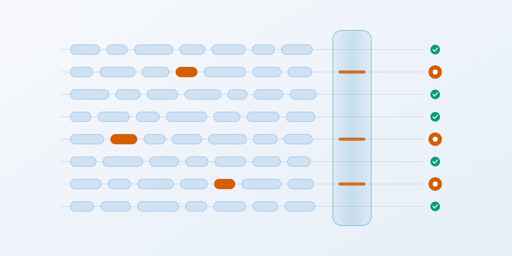

Google 用五个外部基准评估私有预览中的 Agent Anomaly Detection，它异步分析轨迹和日志，供事后复核，不阻止动作执行。

11 月 12 日的报告中，有结果的会话里已执行有害指令检出率为 87%，良性会话误报为 2%～16%；记忆投毒引发行动的会话仅检出 4/18，实验限于单一模型和模拟应用。

落地建议：先用自己的正常高权限工具调用测误报，把付款、外发消息的审批放在执行前，不要交给事后告警兜底。

### [用隐藏链接识别不守规则的爬虫](https://shkspr.mobi/blog/2026/11/blunt-banhammer-blocks-basic-bots-ballistically/)

Terence Eden 给个人站点加了一个爬虫陷阱：在 `robots.txt` 禁止访问某个目录，再放隐藏链接，访问该地址的 IP 会写入封禁规则。

它识别的是访问了禁入链接的客户端，不能证明对方一定是 AI 爬虫；IP 还可能被共享或重新分配，作者也列出了有用机器人被封、旧封禁需要清理等问题。

落地建议：在反向代理后先核对可信客户端 IP 的取法，只记命中日志，确认误伤后再加带过期时间和解封入口的规则。

### [Node.js 27 Alpha：提前检查运行时兼容性](https://nodejsdesignpatterns.com/blog/whats-new-in-nodejs-27/)

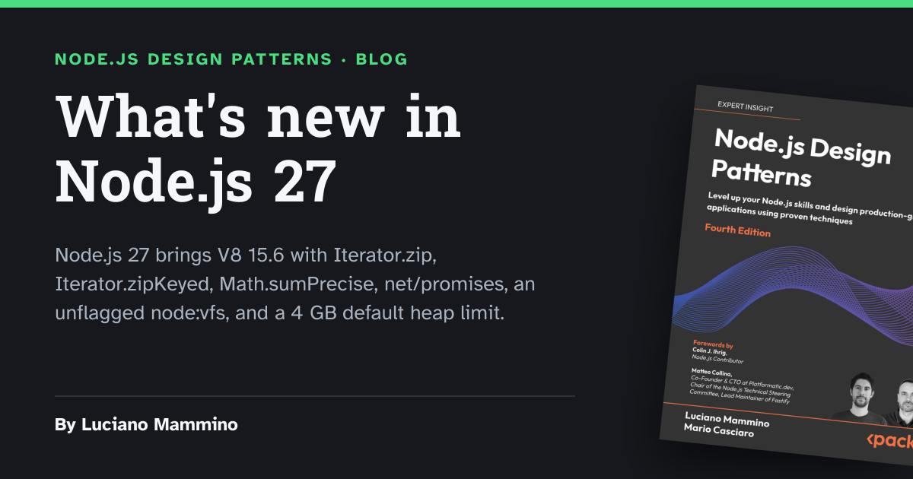

这篇指南整理 Node.js 27 的首个 Alpha，不是稳定版；[官方发布说明](https://nodejs.org/en/blog/release/v27.0.0-alpha.0.0.0)日期是 10 月 29 日。

V8 升至 15.6，加入 `Math.sumPrecise()` 等能力；`v8.serialize()` 等使用的新序列化格式不能被旧版本读取，混用运行时的缓存和队列消费者需要单独检查。

落地建议：库作者可加一条不阻塞发布的 Alpha CI，重点测跨版本序列化；生产服务暂留在受支持的 LTS 版本。

## 工具推荐

### [eve 1.0：可恢复执行的 Agent 框架](https://vercel.com/blog/eve-is-now-generally-available)

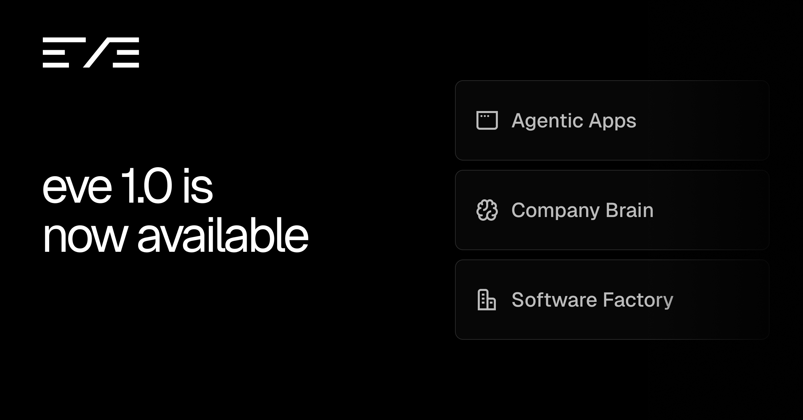

Vercel 将开源 Agent 框架 eve 推至 1.0 正式版，模型循环、工具、子 Agent 和审批都可配置，也能接 Slack 等消息渠道。

Workflow SDK 保存执行进度，使运行中断后能从已完成的步骤继续；共享会话会区分发言者和审批人，本地初始化要求 Node.js 24 或更新版本。

落地建议：用官方 CLI 起测试项目，在工具执行后模拟中断，核对恢复时是否重复产生外部副作用。

### [自托管 Claude Managed Agents：控制面也留在自己的环境](https://claude.com/resources/articles/self-hosted-claude-managed-agents)

Claude Managed Agents 的自托管版本进入私有测试，可把执行框架、沙箱、凭证和会话历史放在自己的云或机房，不只是自托管沙箱。

模型请求仍发往所选供应商或网关，并非离线部署模型；受支持的 API 和 MCP 调用通过沙箱外代理注入凭证，已有 ZDR 协议按 Messages API 请求同样适用。

落地建议：有内网部署要求的团队先申请测试资格，画清模型请求离开内网的路径，再对照现有数据保留协议判断能否接入。

### [Devin Apps：带登录权限的内部应用](https://devin.ai/blog/devin-apps)

Devin Apps 把生成的 Web 应用托管在 Devin 的云主机上，提供稳定链接，访问者必须登录 Devin，可按人员、组织或企业控制访问范围。

应用跑在单机上，无人使用时休眠，首次唤醒可能要几秒，按机器唤醒时长计费；官方定位是内部工具和看板，不是高流量生产托管。

落地建议：先做只读指标页，分别用有权限和无权限的账号访问，确认共享边界，并实际等待一次休眠后再测首屏。

### [Replit Missions：先约定验收、预算和审批](https://replit.com/blog/introducing-replit-missions)

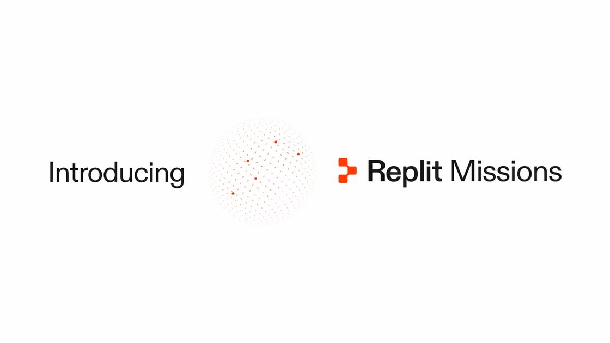

Replit Missions 根据目标协调多 Agent 规划、开发和测试，开始前约定成功标准、预算上限，以及哪些动作必须征得同意。

独立 AI 评审按约定标准检查结果，预算用完即停；官方展示两天、3,000 美元预算内构建 DataCat 的案例，但这不是任意项目的固定交付报价。

落地建议：首个任务选可自动验收的内部工具，把对外联系、发布销售材料和变更客户承诺列入必须人工批准的动作。

### [Hugging Face 改用 OpenRouter 路由语言模型](https://huggingface.co/blog/openrouter)

Hugging Face 将语言模型请求交给 OpenRouter 路由，仍用原有 token 和 API，供应商失败可在同次调用内重试。

语言模型不再支持自带供应商密钥，这是破坏性变化；`X-HF-Session-Id` 可帮助会话保持缓存路由，图像、视频和音频生成仍走原来的路径。

落地建议：先搜配置里的自定义供应商密钥依赖，再给每段会话固定一个 Session ID，核对账单归属和供应商禁用设置。

### [Liquid d1.2：从判断扩展到带出处的抽取](https://www.liquid.ai/blog/d1-2)

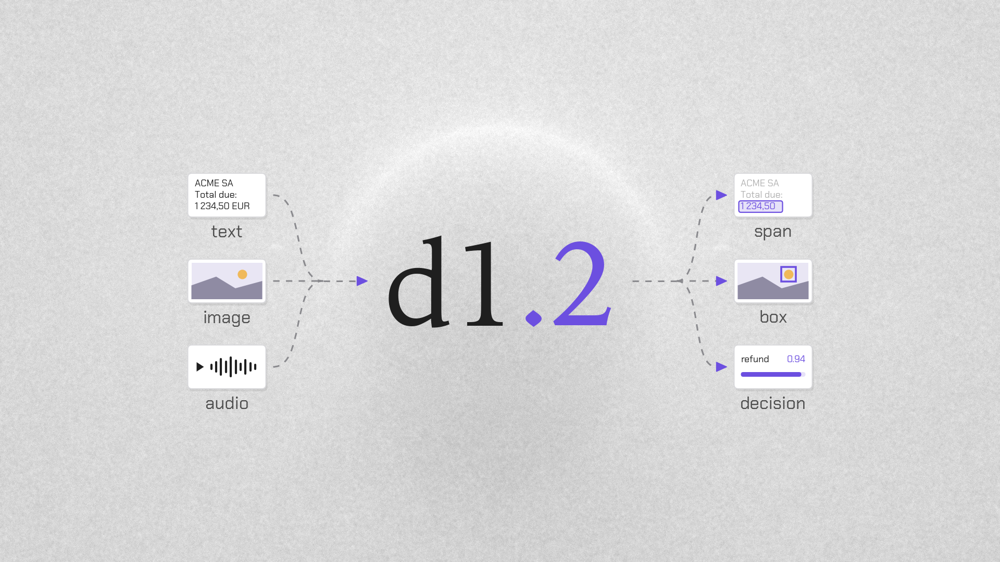

Liquid 发布 d1.2 和 d1.2-ultra，新增音频输入，以及读值、文本片段定位、图像框选、数值估计和多选任务。

读值任务可返回对应原文字符，找不到时返回未找到；目前在 Liquid API 提供，只收输入 token 费，d1.2／ultra 每百万分别为 0.02／0.042 美元。

落地建议：拿缺少税额的发票测试读值接口，把“未找到”接成人工补录，不要在缺字段时自动估算后写入财务记录。

### [Microsoft-Decision-1.1：图像输入与决策模型正式版](https://commandline.microsoft.com/microsoft-decision-model-ga/)

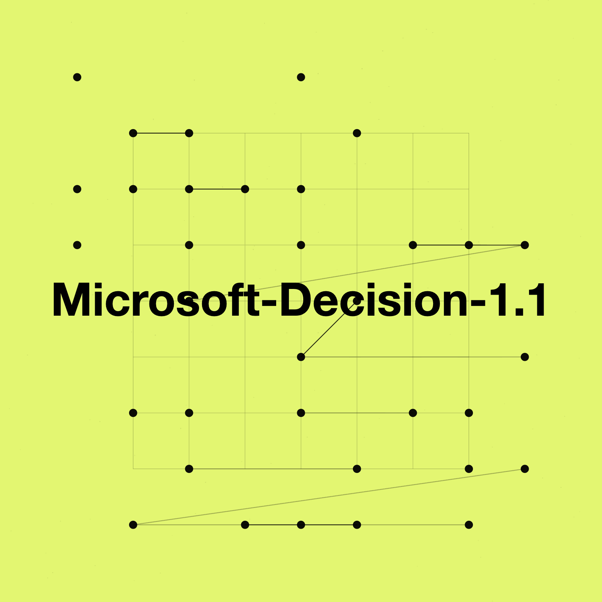

Microsoft-Decision-1.1 在 Foundry、OpenRouter 和 Vercel 正式可用，新增图像输入，可做分类和工作流控制。

模型按开发者给定的选项作出决策并提供置信度；Foundry Global Standard 输入每百万 token 为 0.042 美元、输出免费，其他数据区域的费率不同。

落地建议：给 Foundry 分类流程加入截图样本，按错判代价选置信度阈值，低于阈值转人工，不强制选项。

### [Antigravity Orchestrator：在同一次任务里切换模型](https://antigravity.google/blog/gemini-4-hydrogen-in-google-antigravity/)

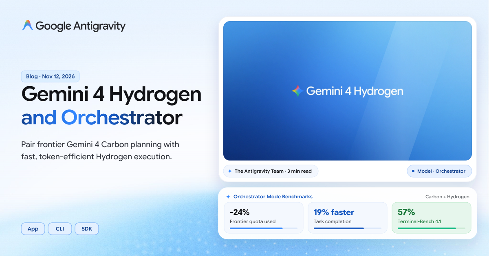

Google 的 Orchestrator 在 11 月 12 日发布，让 Carbon 与 Hydrogen 在任务中协作，不只按首条提示选定模型。

Carbon 可先只读规划，Hydrogen 改代码和跑测试，遇到阻碍再交回规划；Carbon 组合面向 Ultra，付费 Pro 可用 Argon 组合，并非所有档位都有同样模型。

落地建议：Antigravity 订阅者可用常需返工的仓库任务，对照单模型记录成功率、配额和规划接管次数。

### [Embla 1：面向手机的本地推理模型](https://sevren.ai/blog/embla-1)

Sevren 发布可在手机离线运行的 Embla 1，并提供 4 bit 权重；本地运行没有按请求收取的云端 API 费用，但仍占用设备资源。

官方用 iPhone 18 Pro 测 1,024 输入／256 输出 token，自有 Metal 实现耗时 1.77 秒，llama.cpp 为 2.18 秒，不代表任意问题的耗时。

落地建议：做离线问答先按相同输入、输出长度测自己的目标手机，再补长文本和数学样本，不用单机短测结果承诺线上延迟。

### [Cerebras 拆分预填充与解码部署](https://www.cerebras.ai/blog/cerebras-launches-disaggregated-inference)

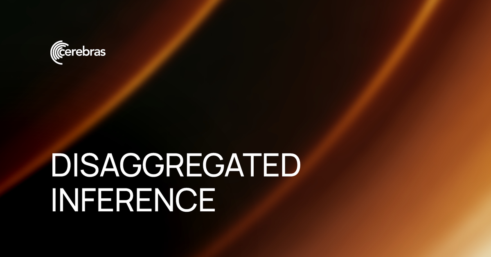

Cerebras 的分离式推理已在生产运行：AMD Instinct GPU 负责处理输入的预填充，CS-3 负责逐 token 生成输出的解码。

官方在 GPT-OSS-120B 的一个共享端点测得每兆瓦吞吐为纯 CS-3 配置的 5 倍，并非单次请求快 5 倍；基础设施合作伙伴可用完整软件栈或仅解码 SDK 接入。

落地建议：推理服务商先按输入输出长度拆分负载，评估 KV 状态经 RDMA 传输的开销，再决定是否采用预填充和解码分离。
